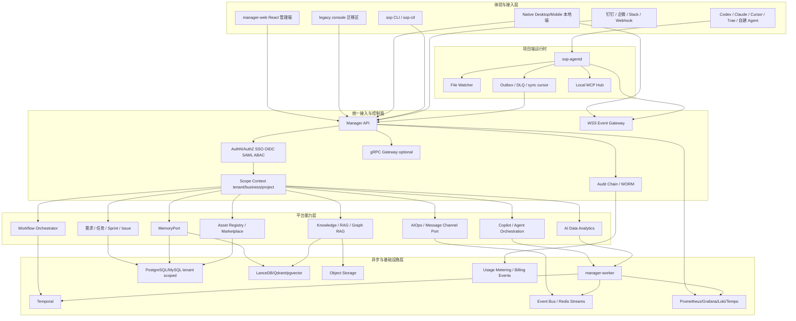
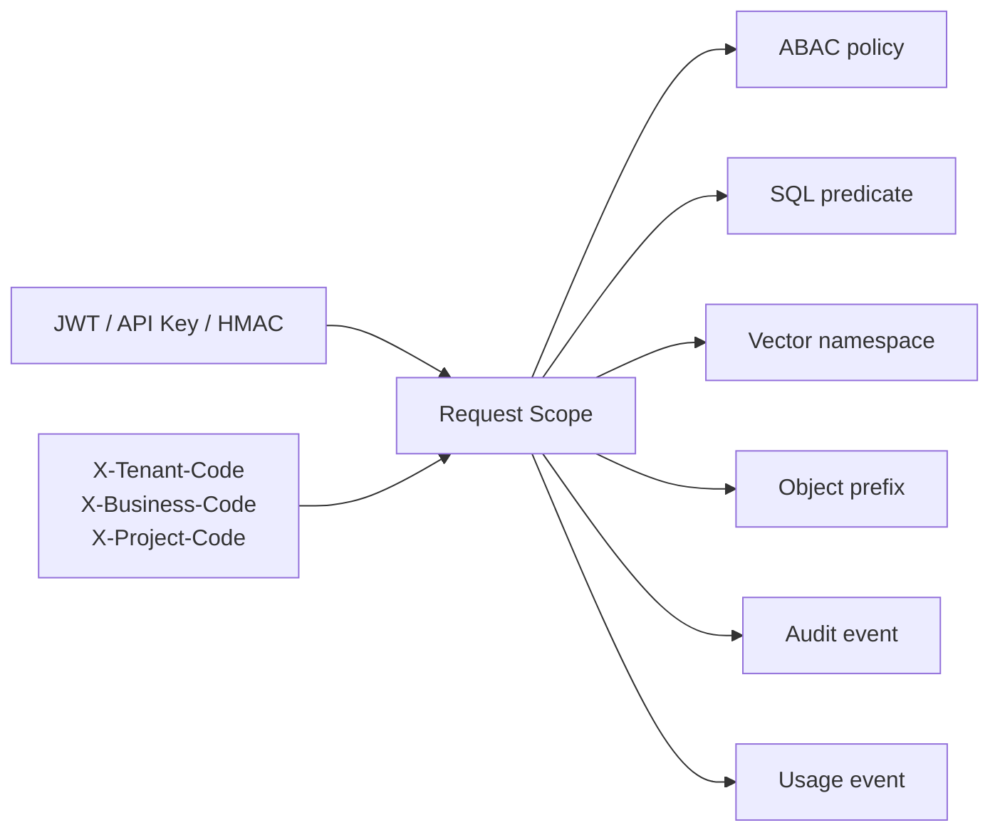
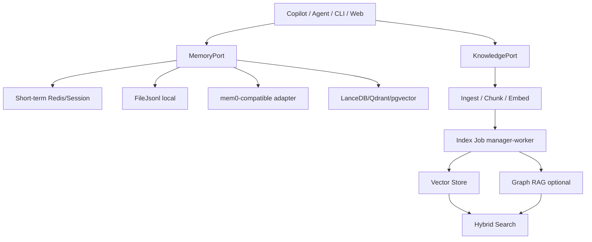
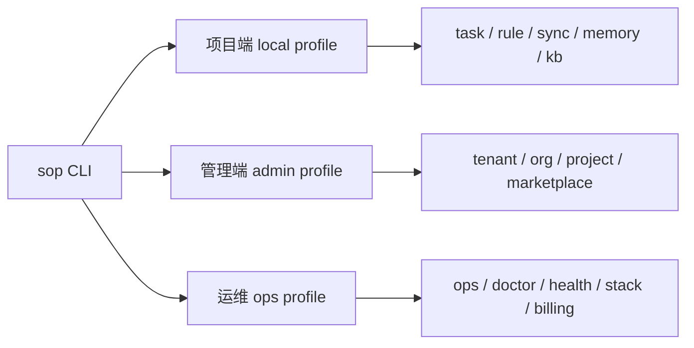
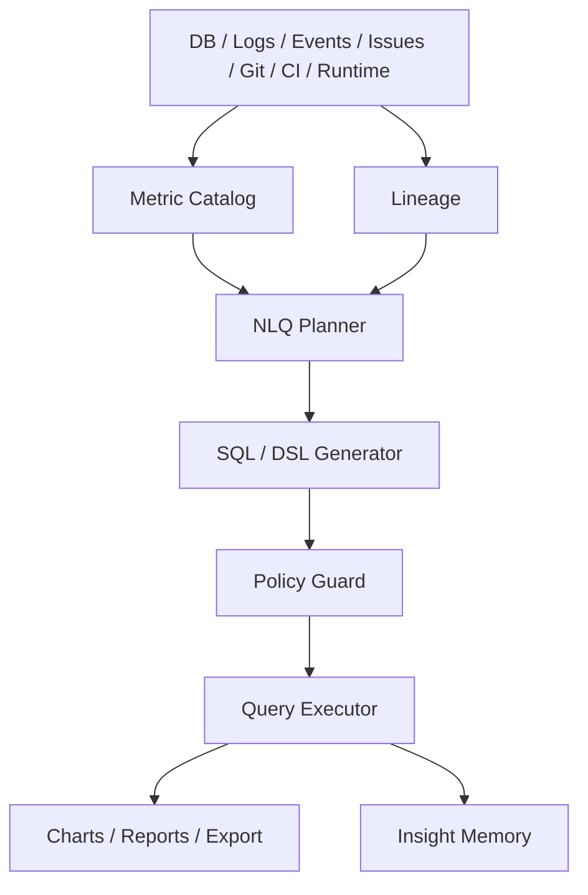
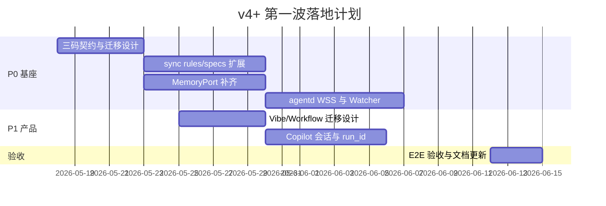

# AI 一栈式平台目标架构与产业化路线

> 版本: 1.0
> 日期: 2026-05-15
> 状态: 面向 v4+ 的目标蓝图与开发任务包
> 关联: [ROADMAP.md](../../ROADMAP.md) · [UPGRADE_v4_ENGINEERING.md](UPGRADE_v4_ENGINEERING.md) · [OVERVIEW.md](OVERVIEW.md) · [EVOLUTION.md](EVOLUTION.md)

## 1. 目标定位

本平台面向大型软件系统的 AI 原生研发、治理、运维与数据分析，目标是形成一个可本地化交付、可 SaaS 化运营、可企业级合规扩展的 **AI + 业务 + Data + DevOps + AIOps 一栈式平台**。

目标态不是把所有工具堆在同一个页面里，而是用统一的上下文、统一的权限、统一的事件与同步协议，把以下能力沉淀成可复用资产：

| 资产类型 | 沉淀内容 | 复用边界 |
|----------|----------|----------|
| 业务资产 | 需求模板、业务能力、流程编排、领域知识 | 租户内共享 / 联邦市场共享 |
| 开发资产 | SOP 规约、代码模板、脚手架、CLI 工具、Agent 工作流 | 项目复用 / 团队复用 |
| AI 资产 | Prompt、Skill、MCP 工具、RAG 数据集、记忆策略 | 按 tenant/business/project 授权 |
| 数据资产 | 指标目录、数据血缘、NLQ 查询、分析报表 | 分级授权与审计 |
| 运维资产 | Runbook、告警规则、自动修复剧本、发布模板 | 环境与租户隔离 |

## 2. 当前基线判断

结合当前仓库，核心 MVP 已经具备：

- Manager API、agent-runtime、sop CLI、SDK、manager-web 轻量壳、LLM Gateway、RAG、memory file/http 适配器、sync pull/push、WSS 事件、worker job 骨架。
- ROADMAP 中 v2/v4 的剩余缺口主要集中在：旧 console 收敛、三码 DB 落库、rules/specs 同步、Watcher/WSS 实时订阅、Temporal 真工作流、SSO E2E、商业化计量、Native 壳与企业级可视化深水区。

因此升级策略采用 **先补平台底座，再迁移高价值产品面，最后商业化闭环**：

1. P0: 上下文隔离、同步、CLI、记忆/知识底座先做完整。
2. P1: console 高价值页面迁入 React 壳，统一管理端体验。
3. P2: Temporal、Worker 面板、SSO、商业化计量与 Native 端产品化。

## 3. 总体架构

## 4. 分层职责

| 层 | 职责 | 关键产物 |
|----|------|----------|
| 体验与接入层 | 管理端、本地端、CLI、IDE Agent、消息通道统一入口 | React Shell、Native Shell、sop CLI、MCP tools |
| 项目端运行时 | 离线优先、文件监听、Outbox、CLI/Agent 本地桥接 | sop-agentd、Watcher、sync store |
| 统一控制面 | 鉴权、租户/业务/项目上下文、限流、审计、WSS/gRPC 网关 | Context middleware、ABAC、Audit Chain |
| 平台能力层 | 研发管理、知识、记忆、工作流、数据分析、运维自动化 | Domain routers/services、Ports |
| 异步基础设施 | Worker、Temporal、事件总线、向量库、对象存储、观测与计费 | manager-worker、Temporal workflows、usage events |

## 5. 三码隔离设计

三码隔离是平台所有能力的硬边界：

实施要求：

| 范围 | 目标 |
|------|------|
| OpenAPI/SDK | 所有项目级接口显式声明 `tenant_code`、`business_code`、`project_code` 来源与错误码 |
| DB | 核心业务表补齐三码列，建立 `(tenant_code, business_code, project_code, updated_at)` 组合索引 |
| 查询 | 所有任务、需求、规约、知识、记忆、审计、用量查询必须由服务端注入三码谓词 |
| 向量/对象 | 客户端不得直接拼 collection/bucket；由服务端映射安全命名 |
| 迁移 | 旧 `tenant_id` / `project_id` 进入双写、双读校验、读切换、停写旧键流程 |

## 6. 记忆与知识系统

记忆与知识库必须保持解耦：

- **Memory** 处理人、项目、Agent、运行过程的长期上下文与偏好。
- **Knowledge** 处理文档、代码、规约、业务资料、数据资产的可检索事实。
- **RAG/Graph RAG** 是检索与推理管道，不直接拥有业务数据。

MemoryPort 目标契约：

| 方法 | 说明 |
|------|------|
| `put` | 写入记忆，带 scope、source、run_id、sensitivity |
| `search` | 语义/关键词检索，服务端强制 scope 过滤 |
| `recent` | 最近上下文，供 Copilot 与 CLI 快速恢复状态 |
| `forget` | 按策略删除或不可逆脱敏，写审计事件 |
| `summarize` | 压缩项目/会话/用户记忆，产出可追溯摘要 |
| `attach_run` | 将记忆与 Agent run、任务、审计链关联 |

优先实现顺序：

1. 扩展当前 file/http 后端，补齐 `forget`、`summarize`、`attach_run`。
2. 引入 mem0 原生 SDK adapter，但保持业务路由只依赖 MemoryPort。
3. 将 rules/specs/knowledge 同步纳入 sync 模块和 Worker 索引。
4. 增加记忆策略：保留期、敏感等级、可共享范围、租户级禁用。

## 7. CLI 与运维工具体系

`sop` 是统一入口，不再拆成项目端 CLI、管理端 CLI、运维 CLI 三套工具。通过 profile 和 context 切换运行面。

目标子命令：

| 域 | 命令 |
|----|------|
| 接入 | `sop register`、`sop init`、`sop login` |
| 上下文 | `sop context use/show/whoami` |
| 研发 | `sop task`、`sop requirement`、`sop sprint`、`sop issue` |
| AI | `sop copilot`、`sop llm`、`sop memory`、`sop kb`、`sop agentd` |
| 同步 | `sop sync pull/push/watch/conflicts` |
| 资产 | `sop template`、`sop marketplace`、`sop platforms` |
| 运维 | `sop ops health/logs/events/deploy/backup/restore/doctor` |
| 商业化 | `sop usage quota/bill/export` |

推荐新工程入口：`sop register <project> --manager <url> --username <user>`。该命令负责初始化项目状态、生成各 CLI/IDE/Agent 接入配置、注册到 Manager、写入 agent.toml/API Key，并运行自检。

运行策略：CLI 和 Agent 遵循“本地优先、远端增强”。本地记忆、知识库、规约、规则、需求、任务在无网络或未注册时可独立使用；当 Manager、记忆服务、知识库服务或数据服务可用时，命令自动调用远端能力，并通过 sync/worker/index 流程更新远端数据。

P0 状态：`sop task` 已支持不依赖 agentd 的 Manager 直连创建/更新/Issue 上报；`sop ops` 已覆盖 health-check、stack doctor、snapshot、deploy profile。

## 8. 前后端分离、Native 与同步

目标通信模式：

| 场景 | 主通道 | 降级通道 | 一致性策略 |
|------|--------|----------|------------|
| Web 管理端 | REST + WSS | REST polling | 服务端版本为准 |
| Native 本地端 | REST + WSS + agentd IPC | Outbox replay | 离线优先 |
| CLI/Agent | agentd IPC + REST | 直连 REST | 幂等键 |
| Worker 任务 | Event Bus + Temporal | Redis Streams | 至少一次 + 幂等 |
| 消息通道 | Webhook/Event ingest | REST callback | CloudEvents |

同步域从当前 tasks/requirements/issues/sprints 扩展为：

- 结构化研发域：tasks、requirements、issues、sprints、projects。
- 规约知识域：rules、specs、templates、skills、mcp tools。
- 运行事件域：agent runs、workflow runs、worker jobs、audit events。
- 本地文件域：通过 Watcher 监听 `.ai-memory/`、`ai-sop/`、项目配置与用户指定知识目录。

冲突策略：

| 数据类型 | 策略 |
|----------|------|
| 任务/需求状态 | 服务端版本 + optimistic lock |
| 规约/文档 | 三路合并，失败进入 conflict queue |
| 记忆 | append-only + summarize/forget 策略 |
| 审计/用量 | append-only，不允许覆盖 |

## 9. 可视化管理域

React Shell 是长期主线，legacy console 只保留迁移缓冲期。页面域按企业级一体化管理拆分：

| 域 | 页面 | 目标能力 |
|----|------|----------|
| 驾驶舱 | Dashboard | 研发、AI、运维、用量统一态势 |
| 租户组织 | Tenants、Organization、Users、Roles | 成员、ABAC、业务线、项目授权 |
| 研发管理 | Requirements、Tasks、Sprints、Issues、Workflows | 需求到交付闭环、进度、风险、评审 |
| AI 智能 | Copilot、Agents、Memory、Knowledge、RAG Jobs | 会话、run_id、知识索引、记忆审计 |
| 数据智能 | Analytics、Metrics Catalog、Lineage、NLQ | 指标目录、血缘、导出、数据问答 |
| 运维管理 | Ops、Events、Notify、Audit、Worker Jobs | 告警、消息通道、审计链、任务队列 |
| 资产市场 | Marketplace、Templates、Skills、MCP Hub | 安装、签名、评分、联邦共享 |
| 平台设置 | Settings、SSO、Billing、Deploy | IdP、配额、计费、部署模式 |

console 迁移优先级：

1. Vibe、编排、MCP、Docker、模型迁入 React。
2. 技能仓、CLI 工具、租户、日志迁入 React。
3. 数据港、审计、市场深水区迁入 React。
4. 默认入口切到 React，console 只读归档后退役。

## 10. AI 数据开发分析能力

AI Data 子系统面向“业务数据 + 研发数据 + 运维数据”的统一分析：

关键原则：

- 指标先入目录，再开放 NLQ，避免 LLM 自由编造指标。
- SQL 生成必须过权限、行级 scope、成本限制和敏感字段策略。
- 分析结果可沉淀为 insight memory，并支持周报、复盘、风险预测。
- 数据开发工作流支持“需求 -> 指标 -> SQL -> 可视化 -> 审核 -> 发布”。

## 11. 企业化、商业化、产业化

| 方向 | 架构能力 | 第一阶段交付 |
|------|----------|--------------|
| 企业化 | SSO/SAML、ABAC、审计链、列加密、WORM、多区域 | Okta/Azure AD/Auth0 至少一家 E2E |
| 商业化 | 租户套餐、用量计量、配额、账单事件、限流 | token/vector/storage/worker 并发四类计量 |
| 产业化 | 插件市场、模板市场、规约市场、联邦 Registry | 签名校验、许可证范围、评分与安装审计 |
| 本地化 | 单机 compose、离线包、本地向量库、本地 LLM | `MODE=single` 一键部署与 snapshot 文档化 |
| SaaS 化 | 多租户 DB、对象存储、观测、Temporal、计费 | `MODE=saas` 一键 deploy-up |

## 12. 开发任务包

### P0: 平台底座闭环

| 任务 | 改动面 | 验收 |
|------|--------|------|
| T0-1 三码 OpenAPI/SDK 正式化 | `apis/openapi`、SDK、middleware | 新接口文档含三码；SDK 自动带 header |
| T0-2 三码 DB 迁移双写 | migrations、core routers | 核心表有三码列和组合索引；旧键双读校验 |
| T0-3 sync 扩展 rules/specs/templates | `sync_api`、agent-runtime puller/watcher | rules/specs/templates 已可 pull/push；push 仅写项目自有扩展目录，后续补 Watcher 与冲突入队 |
| T0-4 WSS 订阅与 agentd 实时同步 | `ws_events`、agent-runtime transport | 任务/知识索引/worker job 状态实时到端 |
| T0-5 MemoryPort 补齐 | memory_store、memory_api、CLI | `forget/summarize/attach_run` 已在 file/http 后端、API、SDK、CLI 可用；后续增强审计策略 |
| T0-6 `sop task` 离线降级 | sop-cli、SDK | agentd 不在线时可直连创建/更新任务 |

### P1: 产品体验统一

| 任务 | 改动面 | 验收 |
|------|--------|------|
| T1-1 Vibe 迁 React | manager-web、vibe API | React 页面可发起/查看会话 |
| T1-2 编排/Workflow 迁 React | manager-web、workflow API | 可视化触发、状态、日志 |
| T1-3 MCP Hub 迁 React | manager-web、MCP routers | 工具列表、启停、调试 |
| T1-4 Docker/模型管理迁 React | manager-web、docker/model routers | 环境和模型配置不依赖 console |
| T1-5 Copilot 升级 | Copilot API/web | 会话、run_id、命令面板、上下文引用 |

### P2: 企业与异步能力

| 任务 | 改动面 | 验收 |
|------|--------|------|
| T2-1 Temporal profile 实测 | compose、workflow.py、worker | Sprint/Review/Bug 使用 `@workflow.defn` |
| T2-2 Worker 任务面板 | worker_jobs、manager-web | job 进度、重试、DLQ、日志可视化 |
| T2-3 SSO E2E | sso.py、web login | 至少一个 IdP 完整登录、JIT、ABAC |
| T2-4 AI Data 指标目录 | data_analytics、web | NLQ 基于指标目录和权限执行 |
| T2-5 Message Channel Port | notify/webhook/events | IM 入站出站统一 CloudEvents |

### P3: 商业化与生态

| 任务 | 改动面 | 验收 |
|------|--------|------|
| T3-1 Usage Metering | audit/events/billing | token/vector/storage/worker 用量出账 |
| T3-2 Quota & Rate Limit | gateway、tenant settings | 租户套餐和限额生效 |
| T3-3 联邦市场 | marketplace、asset registry | 跨团队规约/模板/技能共享 |
| T3-4 Native 壳 | native app、agent-runtime | 桌面端登录、同步、Copilot、通知 |
| T3-5 gRPC 默认开启 | proto/server/client | SaaS profile 默认开启并有 mTLS/ApiKey |

## 13. 关键 ADR 建议

后续进入实现前建议补齐以下 ADR：

1. ADR-001: 三码隔离与旧键迁移策略。
2. ADR-002: MemoryPort 与 mem0 adapter 选型。
3. ADR-003: React Shell 收敛与 legacy console 退役策略。
4. ADR-004: Temporal 作为工作流真源的边界。
5. ADR-005: Usage Metering 与商业化计量事件模型。
6. ADR-006: Native 壳技术选型与离线数据边界。

## 14. 近期落地顺序

建议从一个 4 周工程波次启动：

第一波完成后，平台应达到：项目端可离线同步规约/任务/知识，Manager 可实时感知 Agent 与 Worker 状态，记忆具备可遗忘与可摘要能力，React 管理端开始承接旧 console 的高价值能力。
