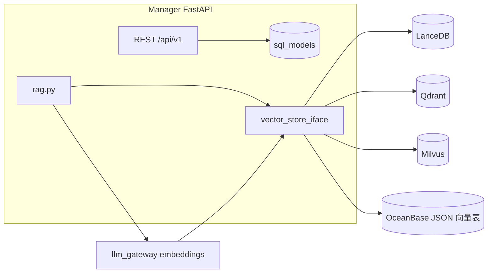

# 数据平面架构（SQL + 向量 + RAG）

## 分层

- **SQL**：租户、项目、任务、审计等；支持 SQLite / MySQL / **OceanBase MySQL 模式**（`DB_TYPE=oceanbase` 与 `mysql` 同引擎路径）。  
- **RAG 向量**：由 `VECTOR_DB_TYPE` 选择 Lance / Qdrant / Milvus / OceanBase(JSON)；与 SQL 可同实例（OB）或独立集群（Milvus/Qdrant）。  
- **管理面向量**（`vector_store.py`）：项目克隆、健康页表统计；与 RAG 后端类型对齐（含 `qdrant`、`oceanbase` 管理适配器）。

## 可扩展性

新增向量实现：在 `vector_store_iface.py` 实现 `VectorStore` 协议并注册到 `get_store()`；若需克隆/表统计，在 `vector_store.py` 增加对称适配器并在 `get_vector_store()` 分支返回。

## 配置权威

环境变量模板：`sop/web/.env.example`。  
运维与脚本索引：`sop/tools/SCRIPTS.md` → **数据与向量**：`sop/tools/DATA_AND_VECTOR.md`。
