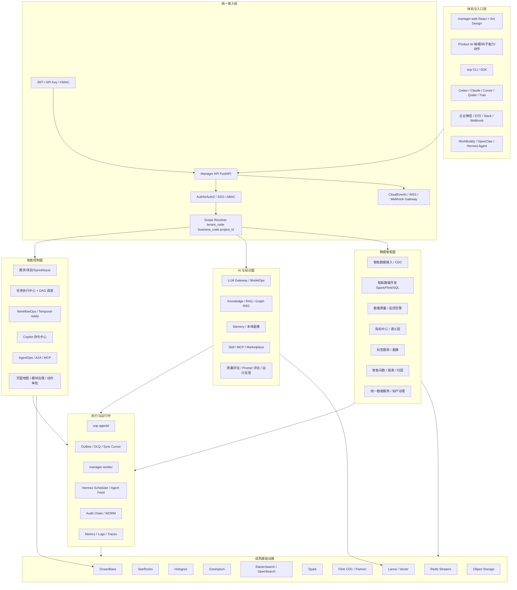
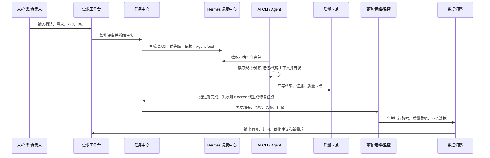
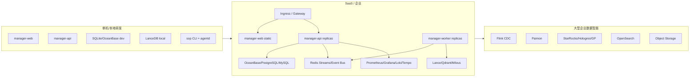

# Hermes 一栈式 AI 全栈研发运维与数据智能平台架构设计

> 版本: 2026.05 latest
> 日期: 2026-05-17
> 状态: 最新目标架构、能力地图与迭代任务拆解
> HTML 架构图: [hermes-platform-latest-architecture.html](hermes-platform-latest-architecture.html)  
> 菜单 IA: [HERMES_PRODUCT_IA_MENU_SPEC.md](HERMES_PRODUCT_IA_MENU_SPEC.md)

## 1. 平台定位

Hermes 的核心目标是把“人管需求、团队和决策，AI/CLI/Agent 负责拆解、开发、部署、运维、数据洞察和持续优化”做成企业级一栈式平台。

平台不是简单的项目管理系统，也不是单一 Copilot 页面，而是围绕 `tenant_code`、`business_code`、`project_id` 三层隔离，把需求、任务、调度、Agent、规约、知识、记忆、数据、运维、安全、审计和商业化统一成 AI 能理解、能自动消费、能闭环执行的操作系统。

## 2. 顶层架构

## 3. 三码隔离

所有功能必须默认携带并验证以下作用域：

| 作用域 | 字段 | 说明 |
|--------|------|------|
| 租户 | `tenant_code` | 企业/客户级隔离，控制用户、权限、计费、密钥、资产和审计 |
| 业务 | `business_code` | 业务线级隔离，控制业务资产、指标、标签、流程和团队 |
| 项目 | `project_id` | 开发项目级隔离，控制需求、任务、Agent、记忆、知识、工作流和数据资产 |

实施原则：

- 前端只携带选择态；服务端统一解析并注入 scope。
- SQL、向量库、对象存储、事件、审计、用量、通知全部使用服务端 scope。
- Agent feed、任务调度、数据蓝图和报告任务化必须输出 scope，供 AI/CLI 自动执行时自检。
- 跨租户数据、密钥、记忆、知识和向量 namespace 禁止客户端拼接。

## 4. 核心能力地图

| 能力域 | 当前核心模块 | 最新增强方向 |
|--------|--------------|--------------|
| 战略总览 | Dashboard、Hermes Blueprint | 平台成熟度、风险看板、技术升级路线、菜单能力矩阵 |
| 组织项目 | Projects、Organization | 租户、业务线、项目组合、成员权限、AI/CLI 接入包 |
| 产品需求 | Requirements、Copilot、Notify inbound | 多入口需求采集、相似需求检测、智能验收标准、需求到任务 DAG |
| 研发交付 | Tasks、Scheduler、Agent feed、Workflows | DAG 依赖、质量卡点、事件唤醒、Agent 自主取活和执行回写 |
| 数据智能 | Analytics、Data Exchange、Data Blueprint | 数据接入、数据开发、质量、指标、标签、问数、归因、数据服务 |
| AI 智能 | Copilot、KB、RAG、Memory、Worker | Graph RAG、本体画像、长期记忆、模型路由、质量评估 |
| 平台生态 | Platforms、Marketplace、Notify、MCP | A2A 协议、工具权限、技能市场、企业微信/钉钉/WorkBuddy/OpenClaw/Hermes Agent |
| 安全治理 | Audit、SystemMap、Capability Gate、WORM | ABAC、字段级权限、模块动作审批、风险策略、审计报表 |
| 系统运维 | Settings、SSO、Billing、Observability | 部署 Profile、日志链路、计费配额、高可用、自愈和运行证据 |

## 4.1 产品化菜单结构与权限粒度

新平台菜单按 `域 -> 模块 -> 子能力 -> 动作/能力码` 建模，侧边栏只展示专业域和模块，权限系统按子能力和动作裁决。legacy 能力作为承接清单和验收参考，不复制旧交互。

| 菜单域 | 模块 | 典型子能力 | 权限码前缀 |
|--------|------|------------|------------|
| 战略总览 | 运营驾驶舱 | 平台蓝图、技术升级、风险看板、下一步动作 | `overview.*` |
| 组织项目 | 项目组合、组织权限 | 租户、业务线、项目成员、AI 接入、项目治理 | `portfolio.*` |
| 产品需求 | 需求工作台 | 需求池、智能评审、验收标准、任务拆解、批量治理 | `product.*` |
| 研发交付 | 任务调度、流程编排 | DAG、调度中心、Agent Feed、质量卡点、工作流实例 | `delivery.*` |
| 数据智能 | 指标总览、数据蓝图、报告、血缘、问数 | 指标、标签、质量、血缘、NLQ、报告转任务 | `data.*` |
| AI 智能 | AI 指挥台、知识记忆 | Copilot、命令中心、RAG、记忆、Worker、规则 | `ai.*` |
| 平台生态 | Agent 平台、资产市场、通信集成 | MCP、A2A、模型、插件、企业微信、钉钉、Webhook | `ecosystem.*` |
| 安全治理 | 安全审计、模块治理 | 审计链、权限矩阵、模块动作、审批、legacy 能力承接 | `governance.*` |
| 系统运维 | 系统设置 | SSO、Profile、计费、日志、观测、部署配置 | `system.*` |

## 5. AI 自主开发闭环

## 6. 数据智能平台架构

数据智能面是 Hermes 的第二条主线：让研发、运维和业务持续从数据中学习，并将洞察自动回流为需求、任务、工作流和知识资产。

数据源管理已从智能中枢附属入口提升为数据域核心模块：`GET /api/v1/db-config/connections/summary` 输出连接目录健康、角色/类型/能力覆盖和 Agent consumption；`POST /api/v1/db-config/connections/{name}/metadata-preview` 基于无明文密钥的连接元数据生成表结构、字段和敏感候选预览；`POST /api/v1/db-config/connections/{name}/metadata-sync` 可创建/更新数据接入连接器并同步到 Schema Registry。前端新增 `#/data/sources` 独立工作台，覆盖连接目录、SecretRef、连接测试、元数据发现和接入同步，原 `#/intelligence/datasources` 保留兼容深链。

元数据管理已拆为数据域独立核心模块：`GET /api/v1/metadata/summary` 聚合资产、字段、Schema Registry、敏感字段、血缘和治理缺口；`GET /api/v1/metadata/assets` 与 `/fields` 分别提供资产目录和字段目录检索；`GET /api/v1/metadata/lineage/impact` 基于资产 source 复用血缘图谱输出上下游影响；`POST /api/v1/metadata/assets/{asset_id}/classify` 支持负责人、密级、标签、质量规则和血缘声明更新。前端新增 `#/data/metadata` 独立工作台，并拆分 `overview/assets/fields/lineage` 子路由，避免资产、字段和血缘能力混在单个治理大页。

NLQ 问数采用 LLM Gateway 优先、规则指标引擎兜底的双路径：复杂归因和自由推理走网关，网关不可用或 Provider 失败时仍基于当前项目指标快照返回可解释答案、置信度、关键指标卡、降级原因和 Provider 错误摘要，确保前端、CLI 和 Agent 在离线/限额/故障场景下仍能完成基础问数。

LLM Gateway 生产控制面已补齐 Prompt 审计闭环：`POST /api/v1/llm-gateway/prompt-audit/run` 在模型调用前检测明文密钥、Bearer Token、PII、提示词注入、上下文过长和代码上下文结构化问题，只保存 prompt hash 与脱敏预览，不落库原文；`GET /prompt-audit/runs` 提供审计历史和阻断摘要，`POST /prompt-audit/tasks` 可把高风险发现生成 `source=llm_gateway_prompt_audit` 治理任务。

模型网关前端新增独立“Prompt 审计”单元，支持任务类型、模型、调用角色、最大 token、PII/Secret 策略、负责人和执行工具配置；审计结果展示决策、评分、风险发现、脱敏预览、任务化结果和历史统计，避免把安全治理能力散落在成本或路由页面。

LLM Gateway 跨 Provider 成本归因已形成可执行控制面：`POST /api/v1/llm-gateway/cost-attribution/run` 读取真实 usage ledger 与模型策略，按 Provider、模型、任务类型和调用来源聚合 token/cost/budget ratio，识别预算超限、Provider 集中度过高和高均价模型风险；`GET /cost-attribution/runs` 提供归因历史，`POST /cost-attribution/tasks` 可将发现生成 `source=llm_gateway_cost_attribution` 治理任务。前端模型网关新增独立“成本归因”单元，支持 dry-run 预览、真实持久化、任务化、负责人和执行工具配置，避免成本治理停留在静态统计卡片。

LLM Gateway 模型评测控制面已补齐第一版：`POST /api/v1/llm-gateway/model-evals/run` 支持配置候选模型、评测用例、期望关键词、实际输出、通过阈值、成本预算和延迟 SLO，综合质量、Prompt 安全、Provider 健康、限流、成本效率与延迟评分生成模型排名；`GET /model-evals/runs` 提供评测历史，`POST /model-evals/tasks` 可把低分模型、阻断用例或最优模型未进入主路由等问题生成 `source=llm_gateway_model_eval` 治理任务。前端模型网关新增独立“模型评测”单元，支持 JSON suite、实际输出评分、评测落库和历史回看，为模型路由、fallback 和成本策略提供可复用依据。

技术选型：

| 技术 | 角色 | 采用策略 |
|------|------|----------|
| OceanBase | 主数据、HTAP、多模态能力、审计 | 作为企业默认主存储和统一数据服务底座 |
| StarRocks | 高并发 OLAP、指标服务 | 承载指标中心和实时看板的查询加速 |
| Hologres | 云上实时数仓与服务 | 对接 Flink/Paimon，服务实时数据应用 |
| Greenplum | MPP 离线数仓 | 适配存量企业数仓、复杂 SQL 和历史归因 |
| ElasticSearch / OpenSearch | 搜索、日志、告警检索 | 服务全文搜索、日志检索、知识检索和告警分析 |
| Spark | 离线 ETL、质量批检、训练样本 | 接入数据开发和模型训练样本加工 |
| Flink / Flink CDC / Paimon | CDC、实时 ETL、湖仓表 | 支撑实时集成、实时质量和实时标签 |
| Lance / LanceDB | 本地向量、多模态资产、记忆 | 支撑本地优先 RAG、代码/文档检索和 Agent 记忆 |

## 6.1 底层技术升级路线

| 升级域 | 目标技术栈 | 阶段 | 升级策略 | 护栏 |
|--------|------------|------|----------|------|
| 企业主存储 | OceanBase、MySQL-compatible SQL | P0 | OceanBase 作为 SaaS/私有化默认主存储，SQLite 仅保留本地开发模式 | 三码列、组合索引、审计字段、SecretRef |
| 批流一体数据底座 | Flink CDC、Spark、Paimon、StarRocks、Hologres、Greenplum | P1 | 数据接入、数据开发、质量评估、指标服务和标签服务统一控制面 | Schema Registry、血缘、质量 SLO、告警转任务 |
| 知识图谱与多模态记忆 | Lance、OpenSearch、Graph RAG、本体记忆 | P1 | 规约、代码、需求、运行证据、数据血缘统一进入知识/记忆层 | 租户向量 namespace、记忆生命周期、脱敏、证据回传 |
| 调度与工作流内核 | Temporal-ready WorkflowOps、Redis Streams、Outbox/DLQ、CloudEvents | P1 | 调度中心输出 AI 可消费任务包、DAG、事件唤醒和质量卡点 | 幂等键、重试策略、人工审批、执行证据 |
| Agent/MCP/A2A 运行底座 | sop-agentd、MCP Hub、A2A Gateway、Skill Marketplace | P0 | 统一 Agent 注册、能力画像、工具权限、心跳、任务领取和执行回写；SDK IPC 支持 Unix Socket / Windows named pipe、结构化诊断和离线降级 | 工具白名单、沙箱执行、HMAC/JWT、动作审计 |
| 产品化前端 | React 18、Ant Design 6、TanStack Query、lazy chunks | P0 | 专业域菜单、模块 Manifest、细粒度 capability、AI surfaces 和构建性能治理 | 域/模块/子能力注册、按钮动作审计、页面地图校验、chunk 预算 |
| 安全可观测治理 | OpenTelemetry、Prometheus、Grafana、Loki、Audit WORM、ABAC | P2 | 日志、指标、链路、审计、用量、账单和审批策略统一治理 | 字段级权限、审计不可篡改、配额限流、策略审批 |

前端性能治理已接入真实构建产物审计：`/api/v1/system/pages/frontend-performance` 读取 `manager-web/dist/assets`，按 raw/gzip 预算、`load_scope`、`initial_oversize` 和 `deferred_oversize` 输出 Top chunks、风险和 AI 拆分建议；`EChartsPanel` 使用 ECharts 5.0 的按需运行时模块，避免图表页面加载整包 ECharts；全局 AI 命令面板拆为 `CommandPalette` 懒加载组件，移动端微应用导航抽屉拆为 `MobileNavDrawer` 懒加载组件，AI 优先和移动端入口仍保留在主壳，但搜索、命令目录、工具计划候选和移动端菜单过滤只在打开时加载。当前真实构建严格口径性能治理分为 78/watch，剩余重点是主壳 index chunk 的导航注册/共享依赖和 AntV 图谱运行时。

## 7. 调度中心目标能力

Hermes 调度中心不只是定时任务，而是 AI 可消费的执行协议。

| 能力 | 说明 |
|------|------|
| DAG 依赖 | blocks/relates/duplicates，支持环检测、批次计算和阻塞原因输出 |
| 优先级策略 | balanced、quality_first、throughput、cost_saver、ai_first、human_review |
| Agent feed | 输出任务包、scope、质量卡点、回调接口和建议命令 |
| 质量卡点 | 规约加载、需求追溯、实现说明、测试证据、前端视觉、后端隔离、安全审查、运维观测 |
| 事件唤醒 | task.created、task.status_changed、agent_reported、notify.inbound、agent.heartbeat |
| 执行回写 | Agent report 回写进度、状态、confidence、artifact、branch、gate_results |
| 运维闭环 | 可接入 WorkflowOps、Worker、Notify、Audit、Usage、SystemOps |

## 8. 前后台模块化设计

前端模块：

- `Dashboard / 运营驾驶舱`: 平台蓝图、技术升级路线、菜单能力矩阵、风险看板。
- `Projects / 项目组合`: 租户、业务线、项目、模板、成员、接入包、项目治理。
- `Organization / 组织权限`: 租户成员、角色状态、项目成员、业务线权限。
- `Requirements / 需求工作台`: 需求池、智能评审、拆任务、批量治理。
- `Tasks / 任务调度`: 执行列表、看板、依赖图、DAG 调度中心、Agent feed/report。
- `Workflows / 流程编排`: 工作流模板、运行实例、事件、信号和批量运维。
- `Analytics / 数据智能`: 指标、数据智能蓝图、数据交换、血缘、报告、NLQ。
- `Copilot / AI 指挥台`: 会话、命令中心、工具计划、计划转任务。
- `Intelligence / 知识记忆`: 知识、记忆、RAG、规则、用量、反思蒸馏、Worker/Sync。
- `Platforms / Agent 平台`: CLI/IDE/Agent、MCP、A2A、模型、工具 Profile。
- `Marketplace / 资产市场`: 资产目录、安装、评分、签名状态。
- `Notify / 通信集成`: 通信通道、消息流水、入站转任务/需求。
- `Audit / 安全审计`: 审计链、模块动作、审批、风险治理。
- `SystemMap / 模块治理`: 页面/模块 Manifest、能力权限、动作目录、legacy 能力承接。
- `Settings / 系统设置`: SSO、部署 Profile、计费、日志、观测和系统配置。

后端模块：

- `tasks.py`: 任务 CRUD、依赖、批量、智能分发、DAG 调度、Agent feed/report。
- `requirements.py`: 需求 CRUD、评审、批量、任务生成。
- `workflow.py`: 工作流类型、实例、事件、信号、取消。
- `data_analytics.py`: 指标、血缘、报告、NLQ、数据智能蓝图。
- `data_exchange.py`: 数据导入导出、预检、作业记录。
- `hermes.py`: 平台总蓝图、能力成熟度、集成矩阵、缺口任务化。
- `system_pages.py`: 模块能力、Manifest、子能力、动作权限、风险、审批、legacy 能力承接。
- `notify.py` / `webhook.py` / `events_ingest.py`: 外部通信与事件。
- `auth_sql.py` / `tenants.py`: 租户、用户、业务线、项目和权限。

## 9. 集成架构

| 集成对象 | 方向 | 事件 | 目标闭环 |
|----------|------|------|----------|
| 企业微信 / 钉钉 | inbound/outbound | message.received、task.assigned、approval.requested、alert.triggered | 入站消息转需求/任务，任务/报告/告警出站 |
| Slack / Webhook | inbound/outbound | cloud_event.ingested、report.published、workflow.completed | 国际化团队与通用系统集成 |
| WorkBuddy | inbound/outbound | agent.ready、task.accepted、artifact.produced、run.failed | Agent 能力画像、接单、执行证据回写 |
| OpenClaw | inbound/outbound | crawler.started、knowledge.extracted、artifact.produced | 知识采集、数据洞察、RAG 入库 |
| Hermes Agent | inbound/outbound | agent.heartbeat、task.dispatched、run.progress、self_heal.applied | 标准 A2A、沙箱执行、自愈回写 |
| MCP / A2A Gateway | inbound/outbound | tool.called、agent.delegated、memory.updated、approval.required | 工具协议、权限裁决、调用审计 |

## 10. 部署拓扑

### 10.1 OceanBase 生产存储迁移契约

生产存储路径已从“部署建议”收敛为可执行契约：

- 后端统一由 `apps/manager/sop_manager/db.py` 输出 OceanBase MySQL 模式迁移计划、核心表清单、三码字段、三码索引和备份恢复清单。
- DDL 位于 `apps/manager/migrations/001_oceanbase_core_schema.sql`，覆盖 tenants、businesses、projects、users、project_members、requirements、tasks、issues、sprints、audit_logs、webhook_configs、api_keys。
- 生产表按 `tenant_code`、`business_code`、`project_id` 建立组合索引，支持租户/业务线/项目级读取隔离与后续 ABAC/审计查询。
- 运维接口：
  - `GET /api/v1/system/ops/storage/migration-plan`: 输出迁移 manifest、当前 DB 类型、SQLite 开发路径、目标 OceanBase 参数和迁移文件内容。
  - `POST /api/v1/system/ops/storage/migration-smoke`: 检查迁移文件、核心表、三码字段、三码索引、OceanBase MySQL 兼容语法和 SQLite 开发路径。
- Settings 前端新增“生产存储”模块，展示迁移目标、核心表、作用域索引、迁移文件、Smoke 结果和备份恢复清单。
- SQLite 本地开发路径保持不变：`apply_startup_defaults()` 仍将 legacy SQLite URL 落到 `.sop-runtime/db/sop.db`。

### 10.2 Trace 关联观测与根因导航

平台观测链路已形成可执行闭环：

- `metrics.py` 在 HTTP 中间件中生成或透传 `traceparent`、`X-Trace-Id`、`X-Correlation-Id`，并提供进程内 `trace_context()` 供 Agent Run、LLM 调用、数据作业、事件与审计写入同一关联上下文。
- Agent Run、LLM Gateway usage、Data Ingest run、Events journal、Audit Chain 写入时保留 `trace_id`、`correlation_id`、`agent_run_id`。
- `GET /api/v1/system/ops/observability/traces` 支持按 `run_id`、`trace_id`、`correlation_id` 聚合失败 Run、慢 LLM、数据接入失败、事件流水和审计链，输出 `root_cause_navigation` 给前端和 Agent 消费。
- Settings 运行状态模块新增 Trace 根因导航面板，可检索运行链路、查看风险级别、根因线索和可跳转节点。
- OpsCenter 新增 `POST /api/v1/ops-center/rca/insights`，复用 Trace 根因导航并聚合数据质量告警、计费提醒、失败流水线和未关闭 RCA，输出带置信度、证据和建议动作的智能根因候选。
- `POST /api/v1/ops-center/rca/insights/tasks` 可将根因候选预览或落库为治理任务，前端根因分析页新增独立智能归因工作区，支持 run_id/trace_id/correlation_id 检索、告警摘要和任务化操作。
- 根因候选使用稳定 ID，并自动匹配 Runbook 名称、标签和步骤；`POST /api/v1/ops-center/rca/insights/rca` 可将候选一键沉淀为 RCA，保留证据、严重级别、置信度、推荐 Runbook 和来源候选，支撑复盘资产持续积累。
- OpsCenter 前端候选卡片展示推荐 Runbook、匹配分和生成 RCA 操作，RCA 列表展示智能归因来源、置信度与绑定 Runbook，形成“发现根因 - 推荐处置 - 沉淀复盘”的闭环。
- OpsCenter 新增 RCA 关闭前验证契约：`GET /api/v1/ops-center/rca/{id}/verification-plan` 输出根因、处置、证据、服务健康、关联流水线与 Runbook 检查清单；`POST /api/v1/ops-center/rca/{id}/verify` 写入验证历史、验证评分和验证人，验证通过时可自动关闭 RCA。
- OpsCenter 前端 RCA 列表提供“验证计划”和“验证并关闭”操作，展示检查项状态、验证分数和最近验证人，避免 RCA 只靠人工按钮关闭。
- OpsCenter 新增生产告警源控制面：`/api/v1/ops-center/alert-sources` 支持 Prometheus、Grafana、Datadog、Webhook、通用 JSON 和 manual 源注册、测试、启停与同步，密钥只能通过托管引用传入，采集结果标准化为 `/api/v1/ops-center/alerts`。
- OpsCenter 前端新增独立“告警源”工作区，可配置 Endpoint、托管密钥引用、标签和样例 payload，测试或同步后展示标准化告警并自动作为 RCA 智能归因输入。
- OpsCenter 新增告警降噪控制面：`/api/v1/ops-center/alert-noise/policies` 管理分组、RCA 阈值和低优先级抑制策略，`/alert-noise/silences` 管理维护静默，`/alert-noise/evaluate` 输出分组、重复折叠、抑制数量、可行动事件和降噪率。
- OpsCenter 新增告警策略智能推荐：`GET/POST /api/v1/ops-center/alert-noise/recommendations` 基于开放告警、重复分组、降噪率和历史健康分生成可应用建议，`/recommendations/{recommendation_id}/action` 支持应用、忽略和重新打开；应用动作复用现有 policy/silence 模型，避免产生孤立配置。
- OpsCenter 告警源前端新增“策略智能推荐”面板，支持生成推荐、查看原因/影响/置信度、应用到降噪策略或静默规则，并联动策略目录、评估历史和 OpsCenter summary，形成策略效果自优化闭环。
- OpsCenter 新增告警策略效果 A/B 对比：`POST /api/v1/ops-center/alert-noise/strategy-compare` 对基线策略、表单策略和严格高危策略在同一批开放告警上执行对比，输出健康分、可行动 RCA 变化、降噪率、赢家和策略建议；`GET /strategy-compare/runs` 查询历史运行。
- OpsCenter 新增跨源 SLO 预测：`POST /api/v1/ops-center/alert-noise/slo-prediction` 按告警源和服务聚合开放告警、采集失败和降噪效果，输出预测 SLO 分、违约概率、风险等级和处置建议；`GET /slo-prediction/runs` 查询历史预测。
- OpsCenter 告警源前端将策略增强拆成“策略智能推荐 / 策略效果 A/B 对比 / 跨源 SLO 预测”三个独立单元，避免所有能力堆在同一个列表里，并让 Agent 可消费同一套运行记录与 summary。
- OpsCenter 新增告警 SLO 自动升级：`GET/PUT /api/v1/ops-center/alert-noise/slo-escalation-policy` 管理升级阈值、动作集、IM 通道和负责人，`POST /slo-escalation/run` 支持 dry-run 预览和真实执行，真实执行会生成任务中心治理任务并按 Notify 通道投递 IM 风险简报，`GET /slo-escalation/runs` 查询升级历史。
- OpsCenter 告警源前端新增“告警 SLO 自动升级”独立单元，支持保存升级策略、预览升级、执行升级、查看升级对象、任务数量和 IM 投递计划，形成“预测 - 升级 - 任务 - 通知 - 留痕”的运维闭环。
- OpsCenter 新增策略灰度应用审计：`POST /api/v1/ops-center/alert-noise/strategy-canary/audit` 基于策略 A/B 对比、SLO 预测、自动升级历史和策略目录输出灰度准入分、ready/needs_review/blocked 决策、证据、护栏和回滚触发；`GET /strategy-canary/audits` 查询审计历史，`/strategy-canary/audits/{audit_id}/action` 支持 approve/start/rollback/archive/reject/reopen 状态流。
- OpsCenter 告警源前端新增“策略灰度应用审计”独立单元，支持选择候选策略或 A/B 胜出策略、刷新审计输入、生成准入审计、查看证据与准入说明，并对审计记录执行审批、启动灰度、回滚和归档操作。
- OpsCenter 新增跨模块运维策略联动：`POST /api/v1/ops-center/strategy-linkage/run` 聚合策略灰度审计、SLO 自动升级、RCA、Runbook、自愈策略和发布流水线，输出联动项、模块路由、治理任务、IM 简报和 Agent consumption；`GET /api/v1/ops-center/strategy-linkage/runs` 查询真实执行历史和高风险 summary。
- OpsCenter 告警源前端新增“跨模块运维策略联动”独立单元，支持 dry-run 预览、真实执行、优先级/负责人/执行工具/最大项数/动作集/通道配置，联动任务落入任务中心，IM 投递复用 Notify 通道治理，形成“审计 - 升级 - Runbook/自愈 - 任务 - 通知 - 留痕”的闭环。
- RCA 智能归因会在存在启用降噪策略或静默规则时仅消费可行动告警，避免 info/low 或维护窗口告警直接生成高优先级复盘；前端在告警源工作区内提供策略、静默、评估历史和最近降噪结果。
- OpsCenter Runbook 管理升级为版本治理：创建/更新自动生成不可变快照，`/api/v1/ops-center/runbooks/{id}/versions` 输出版本历史和审计事件，`/versions/diff` 支持版本差异对比，`/versions/{version_id}/action` 支持恢复历史版本和归档非激活版本。
- Runbook 当前激活版本会回写到主 Runbook 记录，RCA 推荐和自愈策略继续读取稳定的当前版本；前端展示版本健康、checksum、变更说明和恢复/归档动作，避免生产处置手册被静默覆盖。
- OpsCenter 新增 Runbook 执行证据自动回填：`GET /api/v1/ops-center/runbooks/evidence` 查看证据记录，`POST /api/v1/ops-center/runbooks/evidence/backfill` 从 RCA 验证历史、自愈动作和关联流水线恢复记录归集证据，计算覆盖率、必填缺口和建议动作，`/evidence/{record_id}/action` 支持确认、归档和重新打开。
- OpsCenter 前端 Runbook 模块新增执行证据面板，支持按选中 Runbook 自动回填、展示证据覆盖率、缺失项、来源链路和确认/归档动作，形成“Runbook 版本 - RCA 验证 - 自愈执行 - 审计证据”的闭环。

### 10.3 IM 深度工作流与通知治理

通信集成从“通道发送”增强为可治理的企业 IM 工作流：

- 入站消息支持 `message_id` / `idempotency_key` 去重，避免企业微信、钉钉、Webhook 重试导致重复创建任务或需求。
- 审批回调统一接入 `POST /api/v1/notify/approvals/callback`，记录审批人、审批状态、来源通道和审计事件，可承接任务质量卡点、发布审批和权限策略审批。
- 任务状态推送统一接入 `POST /api/v1/notify/tasks/status-push`，支持 dry-run 预览、按事件匹配通道和发送审计，便于 Agent/WorkflowOps 将 blocked、failed、success 等状态主动推送到 IM。
- 报告订阅由 `GET/POST /api/v1/notify/report-subscriptions` 管理，支撑质量报告、洞察报告、运行周报的默认通道、周期和过滤条件配置。
- 报告订阅运行中心由 `GET /api/v1/notify/report-subscriptions/runs` 与 `POST /api/v1/notify/report-subscriptions/run` 提供，支持按报告类型、周期、通道筛选，dry-run 预览、force 纳入停用订阅、IM 简报生成、通道投递计划、真实发送和运行历史留痕。
- `GET /api/v1/notify/connectors/health` 聚合通道启停、事件订阅、最近发送/入站流水，输出连接器健康分、健康/降级/停用状态，前端 Notify 增加连接器健康、审批回调、任务状态推送、报告订阅与订阅运行中心五个产品化面板。

### 10.4 商业化运营与配额治理

Billing 从订阅/账单展示增强为可执行的商业化控制面：

- `PUT /api/v1/billing/subscription` 继续作为租户套餐入口，并在应用套餐时同步写入 Usage quota，形成“套餐 -> 配额 -> 用量检查”的联动。
- `GET/PUT /api/v1/billing/overage-policy` 管理超额策略，支持 `allow`、`block`、`approval_required` 三种模式，以及宽限比例、账单到期天数和暂停阈值。
- `POST /api/v1/billing/entitlements/check` 同时检查套餐 feature entitlement、当前 usage quota 和超额策略，输出 `allowed`、`decision`、`feature_allowed`、`quota_allowed`，供 API Gateway、LLM Gateway、Agent Run 和前端操作前置校验。
- `GET /api/v1/billing/dunning` 基于已出账未支付发票输出催收队列、stage、未收金额和下一步动作，支撑客户成功与财务运营。
- 发票快照、状态流转和收款登记会写入 `GET /api/v1/billing/invoices/{invoice_id}/audit` 生命周期审计，前端 Settings 商业计费模块展示超额策略、权益试算、催收队列和发票审计。

### 10.5 移动端与响应式控制台

React Manager 壳从桌面侧栏扩展为桌面/移动双形态控制台：

- 桌面端保留可折叠、可调宽侧栏和全量微应用菜单，适合长期运营、治理与多模块切换。
- 移动端新增抽屉导航，按微应用分组展示核心菜单，并提供运营驾驶舱、任务中心、需求工作台、告警、IM 五个高频入口。
- 移动端底部操作栏固定承载核心工作流，支持 dashboard、tasks、requirements、alerts 和 IM-triggered actions 的快速切换。
- 主内容区包裹 `data-mobile-compact` 响应式容器，统一压缩卡片、统计格、Ant Design 表格和输入控件，降低移动端横向溢出与触控成本。
- 已使用本地桌面视口和 390x844 移动视口截图验证侧栏、移动菜单、底部操作栏和紧凑工作台可见性。

### 10.6 SystemMap 模块完整度任务化

SystemMap 从“看见模块状态”升级为“把模块缺口直接转成可执行任务”的治理入口：

- `GET /api/v1/system/pages/readiness` 继续输出模块前端、后端 API、权限、AI surfaces、产品动作等完整度矩阵，并在 `agent_consumption` 中暴露任务化 API。
- `POST /api/v1/system/pages/readiness/tasks` 支持按模块 ID、领域、状态和关键词筛选，支持 dry-run 预览与实际生成，任务来源统一写入 `source=system_page_readiness`。
- 任务描述包含模块路由、领域、完整度分、gaps、next actions、API 契约、capability、AI surfaces 和子模块数量，便于 Codex/Agent 领取后直接进入实现。
- SystemMap 前端完整度卡片新增“包含完整模块”“预览完整度任务”“生成完整度任务”操作，支持持续增强已完成模块，也支持后续 watch/risk 模块快速派单。
- SDK/CLI 新增 `system_pages_readiness`、`system_pages_readiness_tasks` 与 `sop pages readiness/readiness-tasks`，让 AI CLI 可以离开浏览器直接读取模块缺口并生成治理任务。

### 10.7 三码隔离审计任务化

三码隔离从“审计矩阵”升级为“安全治理任务闭环”：

- `GET /api/v1/system/pages/isolation-audit` 输出 Tasks、Requirements、Analytics、Notify、Agent Runs、OpsCenter、Data Governance、Usage/Billing 等核心域的 `tenant_code`、`business_code`、`project_id` 覆盖、读写保护、guard 和回归测试。
- `POST /api/v1/system/pages/isolation-audit/tasks` 支持按审计域 ID、状态和关键词筛选，支持 dry-run 预览与实际生成，任务来源统一写入 `source=system_page_isolation`。
- 任务描述包含 domain、module、storage、guard、read/write protected、scope fields、已覆盖测试和统一 scope contract，便于 SecurityAgent/Codex 直接领取后补测试或加固文件型 store。
- SystemMap 三码隔离卡片新增“包含已保护域”“预览隔离任务”“生成隔离任务”，既能处理 watch/risk，也能对已保护域做周期性持续审计。
- SDK/CLI 新增 `system_pages_isolation`、`system_pages_isolation_tasks` 与 `sop pages isolation/isolation-tasks`，让 AI CLI 在执行敏感动作前可自动读取隔离状态并生成治理任务。

### 10.8 三码隔离源代码扫描

三码隔离进一步从“声明式审计”扩展到“源码级发现”：

- `GET /api/v1/system/pages/isolation-audit/scan` 扫描 Manager Router 中的文件型存储、`scope_guard.attach_scope`、`scope_guard.scope_matches`、`tenant_code/business_code/project_id` 字段和当前 scope 解析信号，输出 protected/watch/risk 文件清单。
- `GET/POST /api/v1/system/pages/isolation-audit/scan/runs` 支持保存和读取源码隔离扫描快照，固化 filters、summary、findings、created_by、note 与 Agent consumption，作为安全基线和趋势回放入口。
- `GET /api/v1/system/pages/isolation-audit/scan/runs/compare` 支持按 `base_id/target_id/q/status` 对比历史快照与当前扫描，识别新增风险、回退、已修复项、评分变化和下一步 Agent 推荐动作。
- `POST /api/v1/system/pages/isolation-audit/scan/runs/compare/tasks` 支持将智能基线对比中的新增风险、回退、变化项预览/生成 `source=system_page_isolation_scan_compare` 治理任务。
- `POST /api/v1/system/pages/isolation-audit/scan/tasks` 支持将源码扫描项按状态、关键词和模块 ID 预览/生成 `source=system_page_isolation_scan` 源码加固任务。
- `GET /api/v1/system/pages/isolation-audit` 同步返回 `source_scan_summary`，SystemMap 可在隔离卡片内同时展示审计矩阵和源码扫描摘要。
- SystemMap 三码隔离卡片通过独立 `IsolationSourceScanPanel` 承载源码扫描、任务预览和快照历史，并抽离 `IsolationBaselineComparePanel` 单元承载智能基线对比、差异表和对比风险任务化；页面只负责查询和 mutation 编排。
- 模块治理菜单同步拆成页面注册表、模块 Manifest、能力权限、模块完整度、三码隔离审计、源码隔离扫描、智能基线对比、治理任务化、动作目录和迁移任务，前后端 capabilities、导航 path、i18n 子菜单和权限能力码保持一一对应，避免把治理功能堆在单一页面入口。
- A2A 工作台、注册表、能力协商、SLA、执行窗口、任务分发和执行证据等 focused 子路由均作为一级可检索导航文案进入 zh-CN/en-US/ja-JP，多语言健康检查 `missing_i18n` 与 `missing_sub_i18n` 清零，避免真实子路由退化为技术 ID。
- `GET /api/v1/system/pages/governance-tasks` 聚合 `system_page_readiness`、`system_page_isolation`、`system_page_isolation_scan`、`system_page_isolation_scan_compare`、`system_page_backlog`、`system_page_governance` 与 `system_module_action` 等真实任务来源，输出状态、优先级、来源 lane、跳转 URL、批量处置契约和 Agent consumption；`POST /api/v1/system/pages/governance-tasks/bulk-update` 只允许对上述治理来源任务做 scoped 批量状态/优先级/负责人更新，普通任务与未知 ID 自动跳过并可 dry-run 预览。SystemMap 通过独立 `SystemGovernanceTasksPanel` 呈现治理任务运营看板，使各专业治理单元生成的任务能被统一追踪、筛选、批量处置和跳回任务中心。
- SDK/CLI 新增 `system_pages_isolation_scan`、`system_pages_isolation_scan_tasks`、`system_pages_isolation_scan_runs`、`system_pages_isolation_scan_run_create`、`system_pages_isolation_scan_compare`、`system_pages_isolation_scan_compare_tasks` 与 `sop pages isolation-scan/isolation-scan-tasks/isolation-scan-runs/isolation-scan-run/isolation-scan-compare/isolation-scan-compare-tasks`，AI CLI 可在新增 Router 或文件型 store 后直接读取隔离扫描结果、保存基线、智能对比、任务化风险并派发治理任务。

### 10.9 企业 SSO SAML 生产化契约

企业 SSO 已从 SAML 联调占位升级为可执行生产契约：

- OIDC 保持 Authorization Code + PKCE；SAML 使用成熟 `python3-saml` 适配层处理 AuthnRequest、断言验签、属性读取和认证状态判断。
- SAML 配置支持 IdP EntityID、SSO URL、metadata URL、X.509 证书、NameID Format、SP EntityID、ACS URL、租户域名映射和 IdP group 到平台角色映射。
- `GET /api/v1/sso/{provider}/saml/metadata` 输出标准 SP Metadata XML，供 Okta、Azure AD/Entra ID、ADFS、通用 SAML IdP 导入。
- `GET /api/v1/sso/{provider}/saml/login` 发起 SP initiated 登录，`POST /api/v1/sso/{provider}/saml/acs` 验证 SAMLResponse 后执行 JIT 用户创建/更新、角色映射、租户隔离和审计留痕。
- `POST /api/v1/sso/providers/{provider}/test` 返回 SAML 依赖、IdP/SP 契约、缺失项和可用性诊断；未安装 `python3-saml` 时明确返回安装提示，不再伪装成功。
- Settings 企业 SSO 模块支持 SAML 专项字段、SP Metadata 链接、SAML 登录测试入口、依赖状态和 provider readiness，避免只有框架字段无法落地。

### 10.10 企业 SSO SCIM 用户同步契约

SSO 已补齐 IdP 自动开通/停用用户的 SCIM 入站协议：

- `POST /api/v1/sso/providers/{provider}/scim-token` 为指定 IdP 轮换一次性 SCIM Bearer Token，服务端只持久化 token hash，token 仅在轮换响应中返回。
- `POST /api/v1/sso/providers/{provider}/scim/test` 支持管理员用同一套租户域名映射和 group-role 映射 dry-run 或实际落库测试用户同步。
- `GET /api/v1/sso/scim/v2/{provider}/ServiceProviderConfig` 输出 SCIM 2.0 能力声明，便于 Okta、Azure AD/Entra ID、通用 IdP 自动探测。
- `GET/POST /api/v1/sso/scim/v2/{provider}/Users` 支持用户查询、按 userName 过滤和创建；创建时复用 `_jit_user`，按邮箱域名映射租户，按 groups 映射平台角色。
- `GET/PUT/PATCH/DELETE /api/v1/sso/scim/v2/{provider}/Users/{user_id}` 支持用户读取、覆盖更新、active 状态 patch 和软删除停用，避免 IdP 停用后平台账号继续可用。
- `GET /api/v1/sso/scim/v2/{provider}/Groups` 输出可映射的平台角色/组；`GET/PUT/PATCH /api/v1/sso/scim/v2/{provider}/Groups/{role}` 支持读取、替换、增量添加和移除角色组成员，成员变更会同步到平台用户 `role` 字段，移除成员默认回退 `developer`。
- `GET /api/v1/sso/providers/{provider}/scim/audit` 提供 SCIM 审计报表，汇总 token 轮换、dry-run/apply 测试、Users 创建/覆盖/patch/停用、Groups 替换/增量变更事件；事件详情统一脱敏 token/secret/password/x509/SAMLResponse 等敏感字段，单 Provider 保留最近 200 条，支持按 `event_type`、`status` 过滤。
- `GET /api/v1/sso/providers/{provider}/risk-report` 提供 SSO 风险报表，基于 OIDC/SAML 契约完整度、SAML 依赖与证书、租户域名映射、组到角色映射、SCIM 启用状态、SCIM Token 年龄和 SCIM 审计失败/跳过成员计算 `score/status/findings/action_plan`，风险项只返回稳定 `kind/params/recommendation_key`，前端负责多语言展示，避免后端写死展示文案。
- `POST /api/v1/sso/providers/{provider}/risk-tasks` 将结构化风险项转换为治理任务，支持 `dry_run/include_low/limit/priority/assigned_to/dev_tool`，复用任务中心 `TaskCreate/create_task` 契约并写入 `source=sso_risk_governance`、`source_report_id`、`source_report_title` 和架构文档证据路径，避免 SSO 模块单独维护一套任务落库逻辑。
- `POST /api/v1/sso/providers/{provider}/risk-im-briefing` 复用 Notify 企业 IM 通道与 `im_integration_core` 投递计划，根据 SSO 风险报表生成安全简报；支持 `dry_run` 预览、按 `sso_risk` 事件匹配通道、手动选择通道、实际发送和审计返回，避免 SSO 模块自建消息系统。
- `GET/PUT /api/v1/sso/providers/{provider}/risk-subscription` 将 SSO 风险通知从单次手动发送升级为可配置订阅策略，支持启停、通道白名单、最低风险等级、风险分阈值、频率、低风险纳入、简报上限、负责人和标题配置，配置保存在 Provider 运行时配置中并与密钥脱敏契约隔离。
- `POST /api/v1/sso/providers/{provider}/risk-subscription/test` 复用风险报表和 IM 简报投递计划，按 `force/score_threshold/severity_threshold/subscription_disabled/no_matching_risk` 给出触发原因；dry-run 只返回预览和投递计划，实际发送会写入订阅历史、更新 `last_sent_at` 并尽力写入审计链。
- `GET/PUT /api/v1/sso/providers/{provider}/risk-escalation` 新增 SSO 风险自动升级策略，支持启停、最低风险等级、风险分阈值、冷却窗口、低风险纳入、任务负责人/优先级/工具、IM 通道、升级动作和负责人备注配置，策略与 Provider 运行时配置一起持久化但不混入密钥字段。
- `POST /api/v1/sso/providers/{provider}/risk-escalation/run` 复用风险报表、治理任务化和 IM 简报能力，按 `force/policy_disabled/cooldown/score_threshold/severity_threshold/no_matching_risk` 判定是否触发；dry-run 返回任务和 IM 预览，实际执行会创建治理任务、发送 IM、更新 `last_run_at/last_triggered_at`、写入升级历史并尽力写入审计链。
- `GET/POST /api/v1/sso/providers/{provider}/risk-runbooks` 与 `GET/POST /api/v1/sso/providers/{provider}/risk-runbooks/{runbook_id}[/action]` 新增 SSO 风险处置 Runbook，基于风险报表快照生成结构化步骤、负责人、证据和 Agent consumption；action 支持任务预览/落库、IM 预览/发送、重新验证、步骤完成/失败和归档，复用任务中心与 Notify 通道，不新建孤立执行体系。
- Settings 企业 SSO 模块新增 SCIM 开关、Users/Groups 端点展示、token 轮换、一次性 token 提示、用户同步测试区、SSO 风险报表、SSO 治理任务化、SSO 风险 IM 通知、SSO 风险订阅策略、SSO 风险自动升级、SSO 风险处置 Runbook 和 SCIM 审计报表，保障管理员能在 UI 内完成 IdP 对接、验证、风险治理、通知协作、自动升级、订阅运营、处置归档和审计闭环。
- `GET/POST /api/v1/system/ops/deployment-rollback-runbooks` 与 `GET/POST /api/v1/system/ops/deployment-rollback-runbooks/{runbook_id}[/action]` 新增发布回滚 Runbook 自动化，基于不可变部署包、可选回滚演练和流水线命令生成结构化步骤、负责人、命令/API、证据和 Agent consumption；支持 dry-run 回滚流水线预览、任务预览/落库、真实 rollback 流水线创建、就绪标记和归档。
- Settings 环境 Profile 模块在“发布回滚演练”和“一键部署流水线”之间新增独立 Runbook 自动化单元，可选择部署包、关联演练、配置触发原因/负责人/任务优先级/执行工具，生成 Runbook、预览治理任务、创建任务和创建真实回滚流水线。
- `GET/POST /api/v1/system/ops/deployment-canary-metric-sources` 与 `POST /api/v1/system/ops/deployment-canary-policies/{policy_id}/metric-collection` 新增灰度指标源自动采集，支持 Prometheus/Grafana/Datadog 协议型来源以及 manual/synthetic 本地兜底，按配置查询错误率与 P95 延迟并生成 gate 结果；采集可 dry-run 预览，也可写入灰度策略 gate、失败阻断、通过后自动 start/advance。
- Settings 灰度发布策略详情新增独立指标源自动采集单元，可配置指标源类型、endpoint、查询语句、观测窗口、标签和兜底样本，支持保存来源、采集预览、应用 gate、采集并推进、查看最近样本和 gate 结果。
- `GET/POST /api/v1/system/ops/deployment-execution-audits`、`GET /deployment-execution-audits/{audit_id}` 与 `POST /deployment-execution-audits/{audit_id}/tasks` 新增跨环境执行审计，统一串联部署包、流水线、灰度策略、回滚演练、回滚 Runbook、变更单和执行证据；自动计算证据覆盖、必填缺口、风险分与风险等级，并可将失败/阻断状态和证据缺口任务化。
- Settings 环境 Profile 模块新增独立跨环境执行审计单元，可选择发布关联对象、记录执行状态/风险/变更单/证据链接、查看证据矩阵和最近审计记录，并一键预览或生成治理任务。
- `GET /api/v1/system/ops/deployment-pipeline-executors` 与 `POST /api/v1/system/ops/deployment-pipelines/{run_id}/execute` 新增真实执行器控制面，按 Profile 返回受控执行器目录；执行接口支持 dry-run 计划、命令/阶段选择、非 shell 本地执行、超时、apply 双开关、证据链接、阶段状态回写、execution 记录和审计事件。
- Settings 一键部署流水线详情新增真实执行器单元，管理员可在同一流水线详情中选择执行器、命令、阶段、证据链接、超时和说明，先生成执行计划，再按审批与 apply 护栏受控运行。
- `POST /api/v1/system/ops/deployment-pipelines/{run_id}/remediation` 新增流水线自愈诊断控制面，基于终态失败、取消、未完成卡点、失败阶段、执行器失败/阻断和证据缺口输出结构化 findings、Runbook 步骤、治理任务计划和审计事件；非 dry-run 时复用任务中心生成 `source=system_ops.pipeline_self_heal` 治理任务并回写流水线自愈任务 ID。
- Settings 一键部署流水线详情新增独立自愈诊断单元，管理员可配置低风险纳入、优先级、负责人、执行工具和复盘备注，预览自愈方案、查看风险发现和 Runbook，并把诊断结果一键任务化。
- `GET/POST /api/v1/system/ops/deployment-executor-targets`、`PUT /deployment-executor-targets/{target_id}` 与 `POST /deployment-executor-targets/{target_id}/action` 新增分布式执行目标注册表，支持 Webhook、GitHub Actions、GitLab CI、Jenkins、Kubernetes Job、Temporal Workflow 和远程 Agent 目标；目标只保存 `auth_ref` 密钥引用，支持动作能力、并发、超时、标签、启停、删除和配置检查。
- 执行器目录会自动合并 Profile 可见的执行目标；流水线选择外部目标执行时不会在 Manager 内直接执行 shell，而是生成受控 `queued` 外部编排请求，保留审批卡点、apply 双开关、阶段运行态、execution 记录和审计事件，方便后续接入真实回调与状态同步。
- Settings 真实执行器单元新增“分布式执行目标”管理区，可创建/更新目标、测试配置、启停/删除目标，并将目标直接选为当前流水线执行器。
- `POST /api/v1/system/ops/deployment-pipelines/{run_id}/executions/{execution_id}/callback` 新增外部执行回调状态同步，外部编排器或远程 Agent 可按 execution id 或 external request id 回写 `running/succeeded/failed/blocked/cancelled`；Manager 会同步 execution、external_request、外部运行 ID、证据链接、stdout/stderr、exit_code、阶段状态、流水线终态和审计事件。
- Settings 真实执行器单元新增“外部执行回调”管理区，可从执行历史选择记录，手动登记外部运行结果、证据、输出和元数据，便于没有自动 Webhook 回调的 CI/CD 或远程 Agent 也能完成受控闭环。
- 分布式执行目标新增外部回调签名策略：`callback_secret_ref` 只保存密钥引用，`require_callback_signature` 开启后回调必须携带 timestamp、nonce 和 HMAC-SHA256 签名，Manager 按目标时间窗校验并把验证结果写入 execution/external_request 与审计事件。
- Settings 分布式执行目标表单支持配置回调签名密钥引用、强制签名和时间窗；外部执行回调区支持录入 timestamp、nonce 与 `sha256=` 签名，兼容自动 Webhook 和人工补录场景。

### 10.11 系统运维部署包版本化

系统运维 Profile 已从“即时导出文件”升级为“版本化部署包”：

- `POST /api/v1/system/ops/profiles/{profile}/deployment-packages` 将当前 Profile 固化为带版本号、通道、发布说明、manifest、文件 checksum 和 Agent consumption 的部署包版本。
- `GET /api/v1/system/ops/profiles/{profile}/deployment-packages` 返回指定 Profile 的版本列表，支撑运维按 staging/production/rollback 等通道追踪部署包。
- `GET /api/v1/system/ops/deployment-packages/{package_id}` 返回部署包 manifest、checksum、文件清单和脱敏预览，敏感 env 只展示 `***`，避免把 token/password/secret 泄漏到 UI。
- `GET /api/v1/system/ops/deployment-packages/{package_id}/compose.override.yml` 下载版本化 compose override，使回滚和审计使用固定产物而不是实时重算产物。
- Settings 环境 Profile 模块新增“部署包版本化”单元，可创建版本、查看版本列表、检查 checksum、预览 compose 并下载指定版本产物。

### 10.12 系统运维一键部署流水线

部署包版本化之后，Settings Profile 继续补齐“可预览、可审批、可追踪”的发布流水线闭环：

- `POST /api/v1/system/ops/deployment-pipelines` 基于指定 `package_id` 或 Profile 最新部署包创建流水线 run，支持 `preview/deploy/rollback`、`dev/staging/production/rollback`、`dry_run` 和 `approval_required`。
- `GET /api/v1/system/ops/deployment-pipelines` 支持按 Profile、部署包、状态过滤最近流水线，返回阶段进度、状态、操作人、环境和版本信息。
- `GET /api/v1/system/ops/deployment-pipelines/{run_id}` 返回完整 run，包括标准阶段、可复制命令、安全风险、审计事件和 Agent consumption，便于 CLI/Agent/管理员复盘。
- `POST /api/v1/system/ops/deployment-pipelines/{run_id}/action` 提供 `approve/start/mark_success/mark_failed/cancel` 状态机动作，形成审批卡点、启动、成功/失败归档和取消治理。
- Settings 环境 Profile 模块新增“一键部署流水线”独立单元，管理员可选择版本化部署包、环境、动作、审批策略，生成预览或创建受控发布记录，并在 UI 内推进状态与查看审计事件。
- 后端阶段只返回稳定 `id/label_key/status/params`，前端负责三语种展示，避免把展示文案写死到运行记录中；真实部署执行器后续可在同一 run 契约下替换命令执行层。

### 10.13 系统运维部署包审批发布

部署发布从“能创建流水线”进一步升级为“不可变部署包 + 审批证据 + 受控发布联动”的企业发布卡点：

- `POST /api/v1/system/ops/deployment-package-approvals` 基于部署包创建审批单，记录目标环境、申请人、审批人、审批策略、发布说明、checksum 校验和不可变产物证据。
- `GET /api/v1/system/ops/deployment-package-approvals` 支持按 Profile、部署包、状态过滤审批记录，支撑发布经理查看最近审批和跨环境发布状态。
- `GET /api/v1/system/ops/deployment-package-approvals/{approval_id}` 返回审批详情、检查项、事件流水、关联部署包和发布流水线引用。
- `POST /api/v1/system/ops/deployment-package-approvals/{approval_id}/action` 提供 `approve/reject/publish/cancel` 状态机；`publish` 仅允许已批准审批单执行，并可自动创建受控部署流水线，同时回写部署包 `release_status/published_*` 元数据。
- Settings 环境 Profile 模块新增“部署包审批发布”独立单元，管理员可选择部署包、环境和审批策略发起审批，在同一模块内完成批准、拒绝、发布、取消，并查看检查项、审计事件和关联流水线。
- 审批记录、部署包索引和流水线之间通过稳定 ID 关联，后续可接入多级审批、变更单、IM 通知和灰度发布策略，而不需要重写前端工作区。

### 10.14 系统运维灰度发布策略

部署审批之后，Settings Profile 补齐“逐步放量 + 指标卡点 + 完成/回滚留证”的灰度发布控制面：

- `POST /api/v1/system/ops/deployment-canary-policies` 基于部署包创建灰度策略，配置环境、推进策略、流量阶梯、最大错误率、P95 延迟阈值、观察窗口和自动推进开关。
- `GET /api/v1/system/ops/deployment-canary-policies` 支持按 Profile、部署包、状态过滤策略，返回当前流量、阶段、策略和流水线引用。
- `GET /api/v1/system/ops/deployment-canary-policies/{policy_id}` 返回完整策略、指标 gate、事件流水和 Agent consumption。
- `POST /api/v1/system/ops/deployment-canary-policies/{policy_id}/action` 提供 `start/advance/pause/resume/rollback/complete` 状态机；`start/advance` 会按观测错误率和 P95 延迟执行指标卡点，超阈值自动阻断，`complete` 要求流量达到 100% 后才能联动生成受控部署流水线并回写部署包 `canary_*` 元数据。
- `POST /api/v1/system/ops/deployment-canary-policies/{policy_id}/im-briefing` 复用 Notify 与 `im_integration_core`，按灰度状态、当前流量、指标 gate、回滚/阻断风险生成企业 IM 简报；支持 dry-run 预览、事件匹配通道、手选通道、实际发送和审计留痕。
- Settings 环境 Profile 模块新增“灰度发布策略”独立单元，管理员可配置流量阶梯、指标阈值、观测指标和自动推进策略，在 UI 内完成启动、推进、暂停、恢复、回滚和完成，并查看 gate、事件证据和灰度 IM 风险通知。
- 灰度策略与部署包、审批、流水线、Notify 通道共享稳定 ID，不把策略写死在页面里，后续可继续接入真实 Prometheus/OTel 指标、订阅化 IM 策略和发布回滚演练。

### 10.15 系统运维发布回滚演练

灰度与流水线之后，Settings Profile 新增“回滚可演练、可验证、可留证”的发布安全能力：

- `POST /api/v1/system/ops/deployment-rollback-drills` 基于不可变部署包创建回滚演练，支持 `post_deploy_regression/canary_gate_failure/dependency_outage/manual_rehearsal` 场景、目标环境、负责人、审批要求和 dry-run 预览流水线配置。
- `GET /api/v1/system/ops/deployment-rollback-drills` 支持按 Profile、部署包、状态过滤演练历史，返回检查项总数、通过数、失败数、预览流水线和真实回滚流水线引用。
- `GET /api/v1/system/ops/deployment-rollback-drills/{drill_id}` 返回完整演练记录、稳定检查项、事件流水、部署包 checksum 和 Agent consumption，支撑管理员、CLI 和 Agent 复盘发布恢复能力。
- `POST /api/v1/system/ops/deployment-rollback-drills/{drill_id}/action` 提供 `start/pass_check/fail_check/create_rollback_pipeline/complete/cancel` 状态机；完成前必须所有必要检查项通过，存在失败项时阻断完成，完成时可联动创建真实 `rollback` 流水线。
- Settings 环境 Profile 模块新增“发布回滚演练”独立单元，可选择部署包、场景、负责人和审批策略，创建 dry-run 预览、逐项通过/标记失败、创建真实回滚流水线、完成或取消演练。
- 回滚演练复用部署流水线执行契约，不自建一套执行器；检查项只保存稳定 `id/label_key/status/params`，前端负责三语种展示，后续可接入 Runbook 自动化、IM 通知和真实恢复验证指标。

### 10.16 数据智能决策归因引擎

洞察报告不再只停留在“保存报告 + 批量归因 + 任务化”，数据智能面新增可解释决策控制面：

- `GET /api/v1/analytics/decision/overview` 聚合当前项目洞察报告、归因驱动、高风险报告、证据和建议动作，输出 `decision/summary/evidence/actions/agent_consumption` packet。
- `POST /api/v1/analytics/decision/explain` 支持输入业务决策问题、指定报告集合、证据开关和最大证据数量，返回可解释决策结论、置信度、关键归因和下一步动作。
- `POST /api/v1/analytics/decision/tasks` 可将决策动作按优先级、负责人、执行工具和任务数量预览或生成 `source=analytics_decision_attribution` 治理任务。
- Analytics 洞察报告工作台新增“智能决策归因引擎”独立单元，支持解释、证据查看、任务预览和任务落库，避免把决策能力隐藏在普通报表列表中。

### 10.17 前端主壳首屏性能分层

平台主壳从“所有导航、项目作用域和 API 聚合混在 index”升级为可治理的首屏分层：

- Vite 将 `src/navigation.tsx` 与 `src/microApps.ts` 固定拆为 `navigation-registry` chunk，承载菜单注册、微应用注册和图标映射，System Pages 将其识别为首屏 shell 证据。
- 页面级 `lib/api.ts` 固定拆为 `api-client` chunk，只由懒加载专业工作台消费；App、ProjectSelector、CommandPalette 改用 `lib/appShellApi.ts` 访问认证、菜单偏好、项目/业务线和命令搜索等主壳必需接口。
- `lib/http.ts` 承载统一请求、Token、三码作用域、默认项目补齐、认证失效跳转和非 JSON 指标请求的基础能力，避免多个轻量 API 重复实现鉴权逻辑。
- `/api/v1/system/pages/frontend-performance` 把 `navigation-registry` 归为 `shell/initial`，继续按 `initial_oversize` 与 `deferred_oversize` 分开治理首屏阻塞和低频图谱包。
- 真实生产构建后 `index` 主 chunk 为 486.24KB raw、146.97KB gzip，首屏超预算清零；当前性能治理分为 86/good，剩余风险集中在延迟加载的 `antv-vendor` 图谱包。

### 10.18 图谱运行时用户主动加载

血缘和工作流图谱从“进入页面自动拉取 AntV G6”调整为“默认轻量视图 + 用户主动打开交互图谱”：

- `LineageGraph` 默认展示可横向滚动的轻量血缘分列视图，节点选择、上下游检索和移动端阅读优先可用；需要拖拽、缩放和自动布局时再点击“打开交互图谱”加载 AntV G6。
- `WorkflowDag` 默认展示轻量步骤链，运行态、失败态和当前步骤仍可一眼识别；需要交互 DAG 时再点击“打开交互 DAG”加载 AntV G6。
- `engine="antv"` 仍保留为显式兼容入口，适合后续对少数专业图谱页做强交互默认策略。
- `/api/v1/system/pages/frontend-performance` 新增 `user-activated-visualization` 加载范围与 `user_activated_oversize` 指标，避免把用户主动打开的低频大图谱库误判为首屏或普通路由风险。
- 真实构建后 `initial_oversize=0`、`deferred_oversize=0`、`user_activated_oversize=1`，AntV 大包仍存在但不会阻塞默认页面体验。

### 10.19 生产就绪缺口任务化闭环

生产就绪矩阵从“展示三档状态”升级为“可派发、可跟踪、可由 Agent 消费”的治理闭环：

- `POST /api/v1/system/pages/production-readiness/tasks` 支持按 `domain/stage/q/ids` 筛选模块，默认排除已 production_ready 模块，将 contract/runtime 阶段缺口预览或落库为治理任务。
- 任务来源统一为 `system_page_production_readiness`，`source_report_id=production-readiness:{module_id}`，重复执行 dry-run/apply 不会重复创建同一模块任务。
- 任务描述写入生产阶段、readiness 分、production 分、运行数据、外部连接、异步 Worker、测试覆盖、部署证据、可观测和权限策略维度，以及对应整改建议。
- SystemMap 生产就绪矩阵新增“预览生产任务 / 生成生产任务”，直接复用当前筛选条件，不在页面内堆叠额外复杂表单。
- 治理任务看板新增“生产就绪”来源，使后续平台 Owner、前端、后端和 AI Agent 可以统一领取和追踪生产化缺口。

### 10.20 SystemMap 模块契约中心

模块治理从“Manifest、能力权限、动作目录三个相似页面”收敛为一个轻量契约中心：

- `#/system-map/contract` 是主入口，聚合模块清单、权限能力码和模块动作三个视图，用户不再需要在菜单里理解三套相似页面。
- 旧 `#/system-map/manifest`、`#/system-map/capabilities`、`#/system-map/actions` 保留为兼容深链，进入后自动打开契约中心对应视图，避免破坏 Agent、CLI、收藏和历史链接。
- 前端新增 `SystemModuleContractPanel`，父级 `SystemMap.tsx` 只负责查询、权限判断和动作编排，视图布局、移动端卡片、动作列表和运行历史由独立组件维护。
- 移动端默认卡片流，桌面端保留紧凑表格感；能力矩阵、AI surfaces、动作预览/执行、动作运行历史和 Agent consumption 都保持可操作，不是静态样子。
- 这为后续权限矩阵、菜单管理、Agent 自动改代码和模块动作扩展提供单一稳定落点，降低 SystemMap 大页维护成本。

### 10.21 Settings 外观主题按需模块

系统配置继续从“超大工作台”向“轻量父页 + 专业子模块”演进：

- 外观主题从 `Settings.tsx` 内联卡片抽离为 `settings/SettingsAppearancePanel`，主题偏好状态、`sop-theme` 监听和 `setThemePreference` 动作都在子模块内维护。
- `Settings.tsx` 通过 `React.lazy` 与 `Suspense` 仅在 `activeModule=appearance` 时加载外观模块，父页不再为低频外观配置持有状态。
- 外观模块仍保留真实本地偏好同步和响应式主题卡片，移动端/桌面端都能直接切换主题，不是静态展示。
- 生产构建生成独立 `SettingsAppearancePanel` chunk，后续商业计费、SSO、环境 Profile 等重模块可以按同一模式继续拆分。

### 10.22 Settings 账户会话按需模块

Settings 父页面继续瘦身，账户会话从内联 JSX 改为真实可用的独立子模块：

- `settings/SettingsAccountPanel` 承载账户身份、邮箱/角色、租户、项目、会话错误态、未选项目提示和登出按钮。
- `Settings.tsx` 保留 `api.logout`、`clearSession`、query invalidation 和登录页跳转编排，账户组件只接收 `onLogout` 与展示数据，职责边界清晰。
- 账户模块通过 `React.lazy/Suspense` 仅在 `activeModule=account` 时加载，继续减少 Settings 大工作台的默认维护面。
- 生产构建生成独立 `SettingsAccountPanel` chunk；该模式可继续扩展到 SSO、Billing、Profile 等重配置模块。

### 10.23 Settings 管理入口按需模块

管理入口从 Settings 父页面的内联快捷卡片抽离为可独立维护、可按需加载的专业模块：

- `settings/SettingsWorkspacePanel` 承载组织权限、智能中枢、Vibe、编排、搜索与统一登录入口，所有入口仍指向真实业务深链或登录页，不退化成静态展示。
- `Settings.tsx` 仅在 `activeModule=workspace` 时通过 `React.lazy/Suspense` 加载管理入口模块，父页面继续只负责模块导航与运行编排。
- 管理入口模块使用响应式网格，桌面端保持紧凑扫描效率，移动端自然堆叠，避免把低频入口堆成超长 Settings 页面。
- 生产构建生成独立 `SettingsWorkspacePanel` chunk；后续商业计费、企业 SSO、环境 Profile 和生产存储可以继续按“轻量父页 + 专业子模块 + 真实深链/动作”的模式拆分。

### 10.24 Settings 运行观测按需模块

运行状态与日志观测从 Settings 父页面抽离为真实可操作的运行控制面：

- `settings/SettingsRuntimePanel` 承载 Manager health、metrics、events、observability、Trace 根因导航、日志筛选和日志文件侧栏，继续复用真实 API 和筛选状态。
- `Settings.tsx` 只保留 `health`、`opsObservability`、`opsLogs`、`opsTraceSummary` 查询，以及 `logFilter/traceFilter` 状态；运行视图和日志交互由子模块维护。
- `#/settings/runtime` 与 `#/settings/observability` 复用同一运行观测模块，但标题和入口语义按 active module 区分，避免两套相似页面重复堆叠。
- 响应式布局保留“主内容 + 侧栏”的桌面效率，移动端自然降为单列；日志列表使用固定高度滚动，避免长日志撑爆配置页。
- 生产构建生成独立 `SettingsRuntimePanel` chunk；这为继续拆分 Billing、SSO、Profile 这类重配置模块提供了同一套模式：父页编排数据，专业模块承载交互。

### 10.25 Settings 生产存储按需模块

生产存储从 Settings 父页面抽离为独立的迁移与验证控制面：

- `settings/SettingsStoragePanel` 承载 OceanBase/文件型 store 迁移计划、目标库信息、当前 SQLite 路径、核心表、三码字段、三码索引、迁移文件、备份恢复 checklist 和 smoke checks。
- `Settings.tsx` 只保留 `opsStorageMigrationPlan` 查询、`runStorageSmoke` mutation、`storageSmokeResult` 状态和模块编排，生产存储 UI 不再占用父页面维护面。
- 存储模块保留真实操作：刷新迁移计划、运行 smoke、查看迁移文件大小和备份恢复清单，避免变成静态说明页。
- 响应式布局使用左侧目标与 smoke、右侧指标与迁移列表；移动端自然单列，迁移文件保持紧凑行展示。
- 生产构建生成独立 `SettingsStoragePanel` chunk；下一步可继续按同样方式拆商业计费、企业 SSO 和环境 Profile 这三个重模块。

### 10.26 Settings 商业计费按需模块

商业计费从 Settings 父页面抽离为独立的经营与收款控制面：

- `settings/SettingsBillingPanel` 承载订阅套餐、超额策略、权益试算、经营指标、账单草稿、CSV 导出、账单历史、状态流转、审计记录、收款登记、收款历史和分步抽屉。
- `Settings.tsx` 只保留 billing 查询、draft 状态、mutation 编排和 active module 编排，商业计费 UI 不再占用父页面维护面。
- 商业计费模块保留真实操作：应用套餐、保存超额策略、权益试算、生成账单快照、导出 CSV、更新发票状态、查看审计记录和登记收款。
- 响应式布局保持指标卡、用量额度、出账、收款和审计分区清晰；移动端自然单列，账单与收款列表保留紧凑扫描能力。
- 生产构建生成独立 `SettingsBillingPanel` chunk；下一步继续拆企业 SSO 或环境 Profile，持续降低 Settings 单页复杂度。

### 10.27 Settings 企业 SSO 按需模块

企业 SSO 从 Settings 父页面抽离为独立的身份安全控制面：

- `settings/SettingsSsoPanel` 承载 SSO Provider 配置、OIDC/SAML 模板、密钥脱敏输入、SCIM Token 轮换与测试、角色映射预览、风险报表、风险任务化、IM 简报、风险订阅、自动升级、处置 Runbook、Runbook 步骤流转和 SCIM 审计。
- `Settings.tsx` 只保留 SSO 查询、draft 状态、mutation 编排和 active module 编排，SSO 复杂 UI 不再占用父页面维护面。
- 企业 SSO 模块保留真实操作：保存/测试 Provider、轮换 SCIM Token、预览角色映射、生成风险任务、发送 IM、运行订阅、执行自动升级、生成处置 Runbook、标记 Runbook 步骤和查看审计证据。
- 响应式布局保持“Provider 配置 + 身份安全治理”双栏效率，风险任务、IM、升级和 Runbook 使用抽屉承载配置，移动端自然单列，避免把所有安全操作堆成一个长表单。
- 生产构建生成独立 `SettingsSsoPanel` chunk，Settings 主 chunk 继续下降；下一步拆环境 Profile/部署发布重模块。

### 10.28 Settings 环境 Profile 与部署发布按需模块

环境 Profile 与部署发布从 Settings 父页面抽离为独立的生产运维控制面：

- `settings/SettingsProfilesPanel` 承载环境 Profile 草稿、模板、列表、部署包、审批、灰度策略、灰度指标源、灰度 IM、回滚演练、回滚 Runbook、跨环境执行审计、一键部署流水线、真实执行器、分布式执行目标、外部执行回调和流水线自愈诊断。
- `Settings.tsx` 只保留 Profile/Deployment 查询、draft 状态、mutation 编排、派生选择 ID 和 active module 编排，不再把发布运维复杂 UI 混在父页面。
- 真实操作保留：创建部署包、申请审批、执行灰度、采集指标、发送 IM、创建回滚演练/Runbook、登记执行审计、预览/创建流水线、执行受控命令、同步外部回调、管理分布式执行目标和生成自愈任务。
- 响应式布局保持“Profile 状态 + 发布运维流水”的主从结构；高风险/多步骤操作继续使用抽屉和预览优先流程，避免把生产操作设计成一个超长表单。
- 生产构建生成独立 `SettingsProfilesPanel` chunk，Settings 主 chunk 下降为轻量编排壳；后续治理重点转向 OpsCenter、A2A、LLM Gateway 等其它大工作台的模块拆分与交互简化。

### 10.29 OpsCenter 告警源治理按需模块

OpsCenter 开始从 3000+ 行大工作台向“运行中枢 + 专业治理模块”收敛：

- 告警源治理从 `OpsCenterWorkbench.tsx` 抽离为 `system/ops-center/OpsCenterAlertSourcesPanel`，覆盖生产告警源配置、SecretRef、测试、同步、外部告警、降噪策略、静默规则、策略推荐、A/B 对比、SLO 预测、SLO 自动升级、策略灰度审计和跨模块运维策略联动。
- 父工作台继续持有真实 query、mutation、IM 通道选择、hash tab 和模块身份区；告警源治理视图通过 `React.lazy/Suspense` 仅在用户进入告警模块时加载。
- 子模块保留完整操作闭环：配置抽屉、降噪抽屉、SLO 升级抽屉、灰度审计抽屉和联动抽屉都继续执行真实 API mutation，并展示运行结果、审批状态、任务和 IM 证据。
- 响应式布局延续 data-dense 控制台风格，桌面端保留双栏扫描效率，移动端自然单列；父页面不再堆叠低频告警治理表单。
- 这为后续 RCA、Runbook、自愈策略继续拆成独立按需模块提供模板，也让权限控制、System Pages 能力治理和 AI 单点改造有更清晰的落点。

### 10.30 OpsCenter RCA 治理按需模块

RCA 从 OpsCenter 父工作台抽离为独立的根因治理控制面：

- `system/ops-center/OpsCenterRcaPanel` 承载手工 RCA 创建、智能根因归因、候选证据、Runbook 推荐、归因任务化、智能归因生成 RCA、验证计划、验证并关闭和 RCA 列表证据。
- `OpsCenterWorkbench.tsx` 保留 RCA 查询、mutation、结果状态和 tab 编排；用户进入 `#/system/ops-center/rca` 时才通过 `React.lazy/Suspense` 加载 RCA 子模块。
- RCA 模块继续走真实后端闭环：`opsRcaInsights` 生成候选，`opsRcaInsightTasks` 预览或创建治理任务，`opsRcaInsightCreateRca` 自动入库，`opsRcaVerificationPlan/opsRcaVerify` 完成关闭前验证。
- 手工创建和智能归因配置都使用 Ant Design Drawer/Form/Steps，主区域只保留摘要、候选、验证结果和 RCA 列表，减少长表单堆叠。
- 该模式让 OpsCenter 父页面逐步变成轻量运行中枢，后续 Runbook 和自愈策略可以继续按同样边界拆分。

### 10.31 OpsCenter Runbook 治理按需模块

Runbook 从 OpsCenter 父工作台抽离为独立的执行手册治理控制面：

- `system/ops-center/OpsCenterRunbooksPanel` 承载 Runbook 列表、首版创建、编辑生成新版本、不可变版本历史、历史恢复、版本归档、差异对比、执行证据回填、证据确认/归档/重开和治理审计。
- `OpsCenterWorkbench.tsx` 保留 Runbook 查询、版本查询、证据查询、mutation 和 tab 编排；用户进入 `#/system/ops-center/runbook` 时才加载 Runbook 子模块。
- Runbook 模块继续走真实后端闭环：`opsRunbookCreate/Update` 生成版本，`opsRunbookVersionDiff/Action` 做差异与恢复，`opsRunbookEvidenceBackfill/Action` 维护执行证据。
- 创建/编辑使用 Ant Design Drawer/Form/Steps，主区域聚焦版本列表、证据缺口和审计记录，不把所有表单、版本、证据同时堆在父页面。
- 这让 OpsCenter 的告警、RCA、Runbook 三个高复杂模块都具备独立维护面，后续 AI 修改可以只落到对应专业组件。

## 11. 迭代路线

| 阶段 | 目标 | 关键交付 |
|------|------|----------|
| H0 已完成 | 管理端核心壳与基础研发闭环 | 项目、需求、任务、Sprint、Issue、同步、上下文、登录 |
| H1 已完成 | 智能任务分发与 DAG 调度 | dispatch-plan、scheduler/plan、agent-feed、agent-report、Tasks 调度中心 |
| H2 已完成 | Hermes 平台蓝图与集成矩阵 | /hermes/blueprint、blueprint tasks、Dashboard 蓝图区 |
| D0 已完成 | 数据智能蓝图与任务化 | /analytics/blueprint、sop data、Analytics 数据蓝图 |
| D1 已完成 | NLQ 问数可用性兜底 | /analytics/nlq 规则兜底、前端引擎可解释、sop data nlq |
| H3 下一步 | Agent 执行运行中心 | Agent run 表、heartbeat、能力画像、负载、成功率、失败重试 |
| H4 下一步 | 数据质量中心 | 质量规则目录、质量运行、告警、异常归因、质量报告 |
| H5 下一步 | 指标/标签/画像服务 | 指标语义层、标签目录、画像本体、数据 API 发布 |
| H6 下一步 | 企业级安全与商业化 | ABAC、字段权限、审批、租户账单、用量套餐、审计报表 |
| H7 下一步 | 自愈与智能运维 | 部署流水线、监控根因、Runbook、自动修复、复盘报告 |

## 12. 文档与产物

- 最新 HTML 技术架构图: [hermes-platform-latest-architecture.html](hermes-platform-latest-architecture.html)
- 目标架构与产业化路线: [AI_PLATFORM_TARGET_ARCHITECTURE.md](AI_PLATFORM_TARGET_ARCHITECTURE.md)
- 协议设计: [PROTOCOLS.md](PROTOCOLS.md)
- 数据平面: [DATA_PLANE.md](DATA_PLANE.md)
- 安全设计: [SECURITY.md](SECURITY.md)
- 部署设计: [DEPLOY.md](DEPLOY.md)
