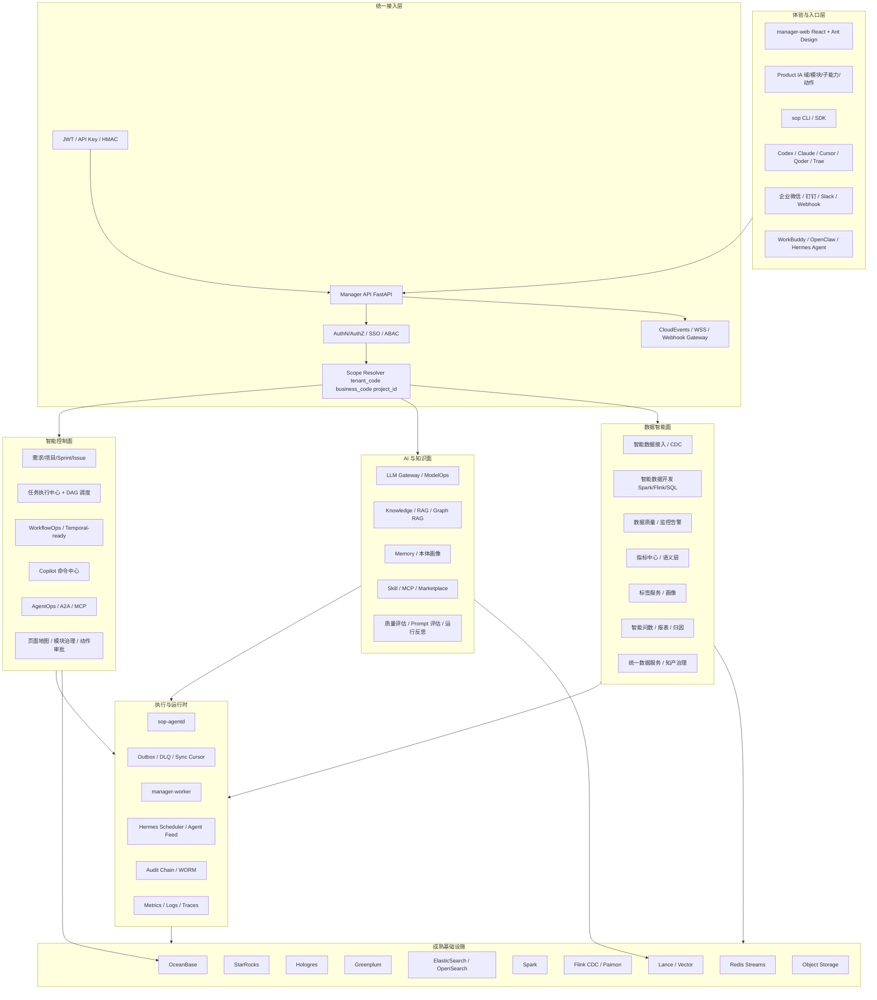
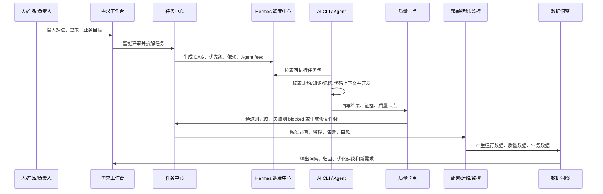
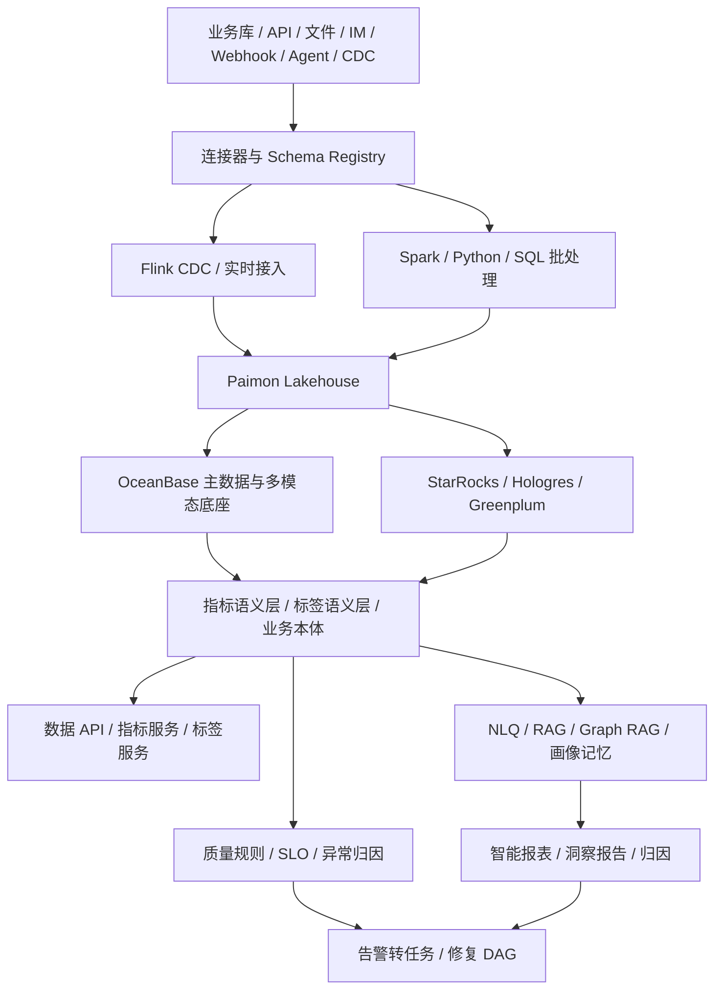
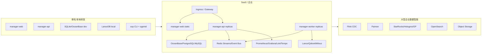

# Hermes 一栈式 AI 全栈研发运维与数据智能平台架构设计

> 版本: 2026.05 latest
> 日期: 2026-05-17
> 状态: 最新目标架构、能力地图与迭代任务拆解
> HTML 架构图: [hermes-platform-latest-architecture.html](hermes-platform-latest-architecture.html)  
> 菜单 IA: [HERMES_PRODUCT_IA_MENU_SPEC.md](HERMES_PRODUCT_IA_MENU_SPEC.md)

## 1. 平台定位

Hermes 的核心目标是把“人管需求、团队和决策，AI/CLI/Agent 负责拆解、开发、部署、运维、数据洞察和持续优化”做成企业级一栈式平台。

平台不是简单的项目管理系统，也不是单一 Copilot 页面，而是围绕 `tenant_code`、`business_code`、`project_id` 三层隔离，把需求、任务、调度、Agent、规约、知识、记忆、数据、运维、安全、审计和商业化统一成 AI 能理解、能自动消费、能闭环执行的操作系统。

## 2. 顶层架构

## 3. 三码隔离

所有功能必须默认携带并验证以下作用域：

| 作用域 | 字段 | 说明 |
|--------|------|------|
| 租户 | `tenant_code` | 企业/客户级隔离，控制用户、权限、计费、密钥、资产和审计 |
| 业务 | `business_code` | 业务线级隔离，控制业务资产、指标、标签、流程和团队 |
| 项目 | `project_id` | 开发项目级隔离，控制需求、任务、Agent、记忆、知识、工作流和数据资产 |

实施原则：

- 前端只携带选择态；服务端统一解析并注入 scope。
- SQL、向量库、对象存储、事件、审计、用量、通知全部使用服务端 scope。
- Agent feed、任务调度、数据蓝图和报告任务化必须输出 scope，供 AI/CLI 自动执行时自检。
- 跨租户数据、密钥、记忆、知识和向量 namespace 禁止客户端拼接。

## 4. 核心能力地图

| 能力域 | 当前核心模块 | 最新增强方向 |
|--------|--------------|--------------|
| 战略总览 | Dashboard、Hermes Blueprint | 平台成熟度、风险看板、技术升级路线、菜单能力矩阵 |
| 组织项目 | Projects、Organization | 租户、业务线、项目组合、成员权限、AI/CLI 接入包 |
| 产品需求 | Requirements、Copilot、Notify inbound | 多入口需求采集、相似需求检测、智能验收标准、需求到任务 DAG |
| 研发交付 | Tasks、Scheduler、Agent feed、Workflows | DAG 依赖、质量卡点、事件唤醒、Agent 自主取活和执行回写 |
| 数据智能 | Analytics、Data Exchange、Data Blueprint | 数据接入、数据开发、质量、指标、标签、问数、归因、数据服务 |
| AI 智能 | Copilot、KB、RAG、Memory、Worker | Graph RAG、本体画像、长期记忆、模型路由、质量评估 |
| 平台生态 | Platforms、Marketplace、Notify、MCP | A2A 协议、工具权限、技能市场、企业微信/钉钉/WorkBuddy/OpenClaw/Hermes Agent |
| 安全治理 | Audit、SystemMap、Capability Gate、WORM | ABAC、字段级权限、模块动作审批、风险策略、审计报表 |
| 系统运维 | Settings、SSO、Billing、Observability | 部署 Profile、日志链路、计费配额、高可用、自愈和运行证据 |

## 4.1 产品化菜单结构与权限粒度

新平台菜单按 `域 -> 模块 -> 子能力 -> 动作/能力码` 建模，侧边栏只展示专业域和模块，权限系统按子能力和动作裁决。legacy 能力作为承接清单和验收参考，不复制旧交互。

| 菜单域 | 模块 | 典型子能力 | 权限码前缀 |
|--------|------|------------|------------|
| 战略总览 | 运营驾驶舱 | 平台蓝图、技术升级、风险看板、下一步动作 | `overview.*` |
| 组织项目 | 项目组合、组织权限 | 租户、业务线、项目成员、AI 接入、项目治理 | `portfolio.*` |
| 产品需求 | 需求工作台 | 需求池、智能评审、验收标准、任务拆解、批量治理 | `product.*` |
| 研发交付 | 任务调度、流程编排 | DAG、调度中心、Agent Feed、质量卡点、工作流实例 | `delivery.*` |
| 数据智能 | 指标总览、数据蓝图、报告、血缘、问数 | 指标、标签、质量、血缘、NLQ、报告转任务 | `data.*` |
| AI 智能 | AI 指挥台、知识记忆 | Copilot、命令中心、RAG、记忆、Worker、规则 | `ai.*` |
| 平台生态 | Agent 平台、资产市场、通信集成 | MCP、A2A、模型、插件、企业微信、钉钉、Webhook | `ecosystem.*` |
| 安全治理 | 安全审计、模块治理 | 审计链、权限矩阵、模块动作、审批、legacy 能力承接 | `governance.*` |
| 系统运维 | 系统设置 | SSO、Profile、计费、日志、观测、部署配置 | `system.*` |

## 5. AI 自主开发闭环

## 6. 数据智能平台架构

数据智能面是 Hermes 的第二条主线：让研发、运维和业务持续从数据中学习，并将洞察自动回流为需求、任务、工作流和知识资产。

技术选型：

| 技术 | 角色 | 采用策略 |
|------|------|----------|
| OceanBase | 主数据、HTAP、多模态能力、审计 | 作为企业默认主存储和统一数据服务底座 |
| StarRocks | 高并发 OLAP、指标服务 | 承载指标中心和实时看板的查询加速 |
| Hologres | 云上实时数仓与服务 | 对接 Flink/Paimon，服务实时数据应用 |
| Greenplum | MPP 离线数仓 | 适配存量企业数仓、复杂 SQL 和历史归因 |
| ElasticSearch / OpenSearch | 搜索、日志、告警检索 | 服务全文搜索、日志检索、知识检索和告警分析 |
| Spark | 离线 ETL、质量批检、训练样本 | 接入数据开发和模型训练样本加工 |
| Flink / Flink CDC / Paimon | CDC、实时 ETL、湖仓表 | 支撑实时集成、实时质量和实时标签 |
| Lance / LanceDB | 本地向量、多模态资产、记忆 | 支撑本地优先 RAG、代码/文档检索和 Agent 记忆 |

## 6.1 底层技术升级路线

| 升级域 | 目标技术栈 | 阶段 | 升级策略 | 护栏 |
|--------|------------|------|----------|------|
| 企业主存储 | OceanBase、MySQL-compatible SQL | P0 | OceanBase 作为 SaaS/私有化默认主存储，SQLite 仅保留本地开发模式 | 三码列、组合索引、审计字段、SecretRef |
| 批流一体数据底座 | Flink CDC、Spark、Paimon、StarRocks、Hologres、Greenplum | P1 | 数据接入、数据开发、质量评估、指标服务和标签服务统一控制面 | Schema Registry、血缘、质量 SLO、告警转任务 |
| 知识图谱与多模态记忆 | Lance、OpenSearch、Graph RAG、本体记忆 | P1 | 规约、代码、需求、运行证据、数据血缘统一进入知识/记忆层 | 租户向量 namespace、记忆生命周期、脱敏、证据回传 |
| 调度与工作流内核 | Temporal-ready WorkflowOps、Redis Streams、Outbox/DLQ、CloudEvents | P1 | 调度中心输出 AI 可消费任务包、DAG、事件唤醒和质量卡点 | 幂等键、重试策略、人工审批、执行证据 |
| Agent/MCP/A2A 运行底座 | sop-agentd、MCP Hub、A2A Gateway、Skill Marketplace | P0 | 统一 Agent 注册、能力画像、工具权限、心跳、任务领取和执行回写 | 工具白名单、沙箱执行、HMAC/JWT、动作审计 |
| 产品化前端 | React 18、Ant Design 6、TanStack Query、lazy chunks | P0 | 专业域菜单、模块 Manifest、细粒度 capability 和 AI surfaces | 域/模块/子能力注册、按钮动作审计、页面地图校验 |
| 安全可观测治理 | OpenTelemetry、Prometheus、Grafana、Loki、Audit WORM、ABAC | P2 | 日志、指标、链路、审计、用量、账单和审批策略统一治理 | 字段级权限、审计不可篡改、配额限流、策略审批 |

## 7. 调度中心目标能力

Hermes 调度中心不只是定时任务，而是 AI 可消费的执行协议。

| 能力 | 说明 |
|------|------|
| DAG 依赖 | blocks/relates/duplicates，支持环检测、批次计算和阻塞原因输出 |
| 优先级策略 | balanced、quality_first、throughput、cost_saver、ai_first、human_review |
| Agent feed | 输出任务包、scope、质量卡点、回调接口和建议命令 |
| 质量卡点 | 规约加载、需求追溯、实现说明、测试证据、前端视觉、后端隔离、安全审查、运维观测 |
| 事件唤醒 | task.created、task.status_changed、agent_reported、notify.inbound、agent.heartbeat |
| 执行回写 | Agent report 回写进度、状态、confidence、artifact、branch、gate_results |
| 运维闭环 | 可接入 WorkflowOps、Worker、Notify、Audit、Usage、SystemOps |

## 8. 前后台模块化设计

前端模块：

- `Dashboard / 运营驾驶舱`: 平台蓝图、技术升级路线、菜单能力矩阵、风险看板。
- `Projects / 项目组合`: 租户、业务线、项目、模板、成员、接入包、项目治理。
- `Organization / 组织权限`: 租户成员、角色状态、项目成员、业务线权限。
- `Requirements / 需求工作台`: 需求池、智能评审、拆任务、批量治理。
- `Tasks / 任务调度`: 执行列表、看板、依赖图、DAG 调度中心、Agent feed/report。
- `Workflows / 流程编排`: 工作流模板、运行实例、事件、信号和批量运维。
- `Analytics / 数据智能`: 指标、数据智能蓝图、数据交换、血缘、报告、NLQ。
- `Copilot / AI 指挥台`: 会话、命令中心、工具计划、计划转任务。
- `Intelligence / 知识记忆`: 知识、记忆、RAG、规则、用量、反思蒸馏、Worker/Sync。
- `Platforms / Agent 平台`: CLI/IDE/Agent、MCP、A2A、模型、工具 Profile。
- `Marketplace / 资产市场`: 资产目录、安装、评分、签名状态。
- `Notify / 通信集成`: 通信通道、消息流水、入站转任务/需求。
- `Audit / 安全审计`: 审计链、模块动作、审批、风险治理。
- `SystemMap / 模块治理`: 页面/模块 Manifest、能力权限、动作目录、legacy 能力承接。
- `Settings / 系统设置`: SSO、部署 Profile、计费、日志、观测和系统配置。

后端模块：

- `tasks.py`: 任务 CRUD、依赖、批量、智能分发、DAG 调度、Agent feed/report。
- `requirements.py`: 需求 CRUD、评审、批量、任务生成。
- `workflow.py`: 工作流类型、实例、事件、信号、取消。
- `data_analytics.py`: 指标、血缘、报告、NLQ、数据智能蓝图。
- `data_exchange.py`: 数据导入导出、预检、作业记录。
- `hermes.py`: 平台总蓝图、能力成熟度、集成矩阵、缺口任务化。
- `system_pages.py`: 模块能力、Manifest、子能力、动作权限、风险、审批、legacy 能力承接。
- `notify.py` / `webhook.py` / `events_ingest.py`: 外部通信与事件。
- `auth_sql.py` / `tenants.py`: 租户、用户、业务线、项目和权限。

## 9. 集成架构

| 集成对象 | 方向 | 事件 | 目标闭环 |
|----------|------|------|----------|
| 企业微信 / 钉钉 | inbound/outbound | message.received、task.assigned、approval.requested、alert.triggered | 入站消息转需求/任务，任务/报告/告警出站 |
| Slack / Webhook | inbound/outbound | cloud_event.ingested、report.published、workflow.completed | 国际化团队与通用系统集成 |
| WorkBuddy | inbound/outbound | agent.ready、task.accepted、artifact.produced、run.failed | Agent 能力画像、接单、执行证据回写 |
| OpenClaw | inbound/outbound | crawler.started、knowledge.extracted、artifact.produced | 知识采集、数据洞察、RAG 入库 |
| Hermes Agent | inbound/outbound | agent.heartbeat、task.dispatched、run.progress、self_heal.applied | 标准 A2A、沙箱执行、自愈回写 |
| MCP / A2A Gateway | inbound/outbound | tool.called、agent.delegated、memory.updated、approval.required | 工具协议、权限裁决、调用审计 |

## 10. 部署拓扑

## 11. 迭代路线

| 阶段 | 目标 | 关键交付 |
|------|------|----------|
| H0 已完成 | 管理端核心壳与基础研发闭环 | 项目、需求、任务、Sprint、Issue、同步、上下文、登录 |
| H1 已完成 | 智能任务分发与 DAG 调度 | dispatch-plan、scheduler/plan、agent-feed、agent-report、Tasks 调度中心 |
| H2 已完成 | Hermes 平台蓝图与集成矩阵 | /hermes/blueprint、blueprint tasks、Dashboard 蓝图区 |
| D0 已完成 | 数据智能蓝图与任务化 | /analytics/blueprint、sop data、Analytics 数据蓝图 |
| H3 下一步 | Agent 执行运行中心 | Agent run 表、heartbeat、能力画像、负载、成功率、失败重试 |
| H4 下一步 | 数据质量中心 | 质量规则目录、质量运行、告警、异常归因、质量报告 |
| H5 下一步 | 指标/标签/画像服务 | 指标语义层、标签目录、画像本体、数据 API 发布 |
| H6 下一步 | 企业级安全与商业化 | ABAC、字段权限、审批、租户账单、用量套餐、审计报表 |
| H7 下一步 | 自愈与智能运维 | 部署流水线、监控根因、Runbook、自动修复、复盘报告 |

## 12. 文档与产物

- 最新 HTML 技术架构图: [hermes-platform-latest-architecture.html](hermes-platform-latest-architecture.html)
- 目标架构与产业化路线: [AI_PLATFORM_TARGET_ARCHITECTURE.md](AI_PLATFORM_TARGET_ARCHITECTURE.md)
- 协议设计: [PROTOCOLS.md](PROTOCOLS.md)
- 数据平面: [DATA_PLANE.md](DATA_PLANE.md)
- 安全设计: [SECURITY.md](SECURITY.md)
- 部署设计: [DEPLOY.md](DEPLOY.md)
