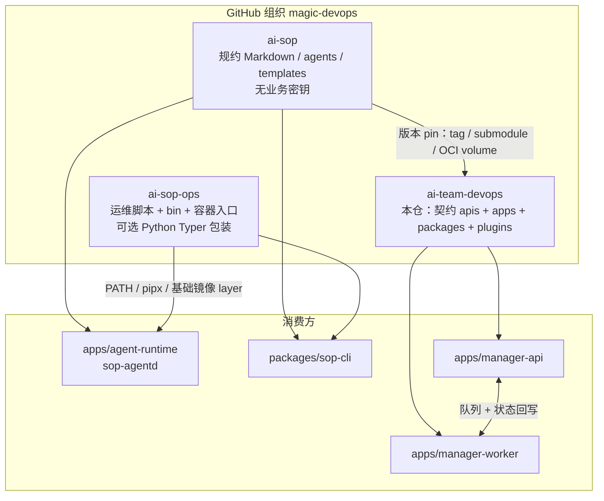

# 平台多仓库架构与 Manager 运行时拆分

> **目标读者**：架构 / 平台 / SRE / 后端负责人  
> **状态**：规范级设计（不要求与当前目录一一对应；实施按阶段迁移）  
> **原则**：`ai-sop` 仅承载 **AI 可读规约与模板**；可执行运维与编排进 **独立工具仓**；管理面 **API 与 Worker 进程分离**，便于伸缩与故障隔离。

---

## 1. 设计目标（可验收）

| 维度 | 目标 | 验收要点 |
|------|------|----------|
| **规约独立** | `ai-sop` 可单独发版、单独 PR、与产品代码生命周期解耦 | 业务仓可只依赖固定 tag 的规约；CI 可校验规约完整性 |
| **运维可执行物独立** | 安装、健康检查、本地起 Manager、清理运行时等与 Markdown 规约分离 | 一条 `pipx install` 或容器内 `PATH` 即可用 `sop-ctl` / `sop-ops-*` |
| **管理面可伸缩** | HTTP 同步路径与长任务/工作流解耦 | API 进程无长阻塞；Worker 可水平扩容；队列积压可告警 |
| **专业运维** | 可观测、重试、幂等、DLQ、配置分层 | 统一 trace_id；任务幂等键；死信可人工 replay |

---

## 2. 目标仓库拓扑



| 仓库 | SSH（建议） | 职责 | **不应**包含 |
|------|-------------|------|----------------|
| **ai-sop** | `git@github.com:magic-devops/ai-sop.git`（**已建库并推送 `main`**） | `specs/`、`agents/`、`knowledge/`、`skills/`、`templates/`、`workflow/*.md`、`quality/*.md`、`memory/*.md`、`core/*.md`、`custom/` 说明等 | 业务密钥、客户数据、与某产品绑死的 Python 服务代码 |
| **ai-sop-ops** | `git@github.com:magic-devops/ai-sop-ops.git`（**已建库并推送 `main`**） | 原 `sop/tools` 中 **可执行** 能力：`start-manager`、`health-check`、`cleanup-legacy-runtime`、`sop-ctl`、`reset-admin`、hook 安装脚本、与本地文件系统强绑定的脚本；可选发布 **OCI 镜像 `ghcr.io/.../sop-ops`** | 大段领域业务规约正文（应引用 ai-sop） |
| **ai-team-devops**（本仓） | 现有 remote | `apis/`、`apps/manager-api`、`apps/manager-worker`、`apps/manager-web`、`apps/agent-runtime`、`packages/*`、`plugins/`、**薄引用** ai-sop | 重复维护一份与 ai-sop 分叉的长期规约 |

> **命名说明**：`ai-sop-ops` 与 `packages/sop-cli` 区分：`sop-cli` 面向 **开发者日常**（`sop task` / `sop login`）；`ai-sop-ops` 面向 **平台运维与本地编排**（起 Manager、自检、清理、备份）。二者可互相调用，但 **依赖方向** 应为 `sop-cli` →（可选）`sop-ops-core` 库，避免循环。

---

## 3. `ai-sop` 规约仓：内容与依赖方式

### 3.1 目录权威（迁入后）

```
ai-sop/
├── README.md                 # 版本策略、兼容矩阵、如何被下游引用
├── VERSION                   # SemVer 或 CalVer，与 tag 一致
├── specs/
├── agents/
├── knowledge/
├── skills/
├── templates/
├── workflow/                 # 流程规约 Markdown
├── quality/
├── memory/                   # 规约级记忆/状态机说明（非运行时 DB）
├── core/
├── custom/                   # 示例与占位说明
└── integrations/             # 仅文档 + 可选「无密钥」MCP 样板
```

### 3.2 下游消费模式（按推荐顺序）

1. **Git Submodule（企业内网常用）**  
   - 在本仓：`specs/ai-sop` 或 `third_party/ai-sop` 指向固定 **commit**。  
   - 优点：可重复构建、审计路径清晰。  
   - 缺点：子模块升级需显式 PR。

2. **发布 Tarball / GitHub Release Asset（CI 友好）**  
   - `ai-sop` Release 附带 `ai-sop-1.4.0.tar.gz`；Docker build `ADD` 或 CI `curl`。  
   - 优点：不拉子模块历史；构建快。

3. **PyPI 包 `sop-spec`（可选）**  
   - 仅打包静态文件，`importlib.resources` 读取路径。  
   - 优点：`pip install sop-spec==1.4.0` 简单。  
   - 缺点：需维护打包流水线。

4. **OCI 镜像只读层（Kubernetes/GitOps）**  
   - 规约作为 `volumeMount` `/opt/sop/spec` 注入 `manager-api` / `agent-runtime`。  
   - 优点：与应用镜像正交升级。

**统一环境变量（建议）**：`SOP_SPEC_ROOT` → 解析后必须存在 `specs/` 与 `agents/` 等约定子树；`manager-api` 与 `agent-runtime` 启动时 **校验目录结构**，失败快速退出（fail-fast）。

---

## 4. `ai-sop-ops` 运维工具仓：与 `sop/tools` 的映射

### 4.1 迁移切片

| 当前路径（本仓） | 目标 | 说明 |
|------------------|------|------|
| `sop/tools/start-manager.sh` | `ai-sop-ops/bin/` + 文档 | 启动的是 **`apps/manager-api`**（见 §6）；脚本内固定 `PYTHONPATH` |
| `sop/tools/health-check.sh` | 同上 | 探活 URL、依赖检查 |
| `sop/tools/sop-ctl.sh` | `sop-ctl` 或 `typer` 子命令 | 可逐步改为 Python 单入口，便于 Windows |
| `sop/tools/reset-admin.py` | `sop-ops-admin` console_script | 仅依赖 `manager-api` 的公共 Python 包或 HTTP Admin API（更解耦） |
| `sop/tools/bootstrap-dev.sh` | `sop-ops-bootstrap` | 组合安装 `sop-cli`、拉规约、可选起 docker compose |
| `sop/tools/*.md`（SCRIPTS、DATA_AND_VECTOR） | `ai-sop-ops/docs/` | **数据平面权威**仍保留在运维侧文档，与 `ai-sop` 中「表设计规约」交叉引用 |

### 4.2 交付形态

- **开发者本机**：`pipx install sop-ops` → `sop-ctl`、`sop-manager-local` 等 entry points。  
- **CI**：`ghcr.io/magic-devops/sop-ops:1.x` 精简镜像，仅含 bash + python3 + 脚本。  
- **与 `sop-cli` 关系**：`packages/sop-cli` 保留 **业务开发者** 命令；`sop-ops` 保留 **平台/运维** 命令；共享库可抽 `packages/sop-common-py`（日志格式、env 解析）。

---

## 5. Manager 拆分：`manager-api` 与 `manager-worker`

### 5.1 职责边界（硬约束）

| 组件 | 进程职责 | 允许 | 禁止 |
|------|-----------|------|------|
| **manager-api** | HTTP/WS 同步 API、鉴权、参数校验、**写命令到队列/Outbox**、读聚合查询 | 短事务（<200ms P99）、SSE/WS 推送订阅、Webhook 签名出站 | 长时 LLM 调用阻塞 worker 线程池（应转异步任务）；在请求内跑 shell 编排（除非明确沙箱且限时） |
| **manager-worker** | 消费任务、重试、幂等、调用 Temporal / 外部 LLM / 向量索引 / 邮件 | 长运行、批处理、指数退避、并行度可配 | 对外直接暴露无鉴权端口（默认）；与浏览器直连（应经网关） |

### 5.2 任务与事件模型（建议默认实现）

1. **命令通道**：Redis Streams 或 PostgreSQL `SKIP LOCKED` 队列表（二选一，saas 已用 Redis 时优先 Streams）。  
2. **工作流引擎**：Temporal（长流程、补偿、人工审批接点）为 **首选**；简单场景可用 **轻量 RQ/Celery** 作为过渡。  
3. **幂等**：每条任务 `idempotency_key`（租户+项目+业务键）；Worker `INSERT ... ON CONFLICT DO NOTHING` 或 Redis `SETNX`。  
4. **状态回写**：Worker 更新 `task_runs` / `workflow_runs` 表；API 只读查询；WebSocket 由 API 或 **Centrifugo** 转发进度事件。  
5. **DLQ**：失败超过 `max_retries` 入 DLQ 表；管理 UI 提供 replay + 原因归档。

### 5.3 部署与网络

```
Internet → Ingress (TLS)
            ├─ /api  /ws   → manager-api (HPA)
            ├─ /app        → manager-web 静态资源
            └─ /internal   → 禁止公网；worker 仅集群内

manager-api → Redis / Postgres / Qdrant（同步短读）
manager-worker → 同上 + Temporal Frontend + 外网 LLM（经 Egress 白名单）
```

- **密钥**：API 与 Worker 共用 **同一** `SECRET_KEY` 仅用于 JWT 校验时，Worker 应使用 **服务账号 JWT** 或 **mTLS** 调 API 内部接口，避免共享用户态密钥。  
- **观测**：统一 `service.name`：`sop-manager-api` / `sop-manager-worker`；`traceparent` 从 API 经消息头传入 Worker。

### 5.4 本仓落地阶段（建议里程碑）

| 阶段 | 内容 |
|------|------|
| **M-A0** | 文档与目录：`apps/manager-api`、`apps/manager-worker` README + 本设计定稿；`OVERVIEW`/`MODULES` 对齐 |
| **M-A1** | 从 `apps/manager/sop_manager` **抽出** `worker/` 包：先跑「空任务心跳」+ 队列消费框架，业务仍留在 API |
| **M-A2** | 将 **明确长任务**（文档解析批处理、大索引、备份打包、工作流推进）迁 Worker；API 改为 `202 Accepted` + `job_id` |
| **M-A3** | Temporal 接入可选 profile；监控队列 lag、DLQ 面板 |
| **M-A4** | `apps/manager` 退化为 meta 包或删除，仅保留 `manager-api` / `manager-worker` 两个可部署单元 |

---

## 6. 与现有代码的对应关系（过渡）

- 当前 **`apps/manager` + `sop_manager`**：在 M-A4 之前继续作为 **单体 API** 真源；新目录 `apps/manager-api` 可先以 **文档占位**，避免双真源。  
- **`apps/manager-web`**：不变，仅对接 `manager-api` 的 OpenAPI。  
- **`sop/` 在本仓**：可与远程 **`magic-devops/ai-sop`** 同步；推荐用 **Git submodule** 替换内嵌目录，步骤见 [../MIGRATE_AI_SOP_SUBMODULES.md](../MIGRATE_AI_SOP_SUBMODULES.md)。运维脚本见 **`magic-devops/ai-sop-ops`**（已推送 `main`）。

---

## 7. 风险与对策

| 风险 | 对策 |
|------|------|
| 规约与工具双仓 PR 不同步 | `ai-sop-ops` CI 集成测试引用 **固定** `ai-sop` tag；发版矩阵文档化 |
| Worker 拖垮 DB 连接池 | Worker 独立连接池上限；只读副本承载报表类任务 |
| 队列丢消息 | Redis Streams `XAUTOCLAIM` + Pending 监控；或 PG outbox + 事务消息 |
| 运维脚本分叉 | `sop-ops` 单一发版线；本仓脚本目录标记 **deprecated** 并设删除日期 |

---

## 8. 参考链接（本仓）

- [OVERVIEW.md](OVERVIEW.md) — 三层五通道总览（将更新为多仓库视图）  
- [MODULES.md](MODULES.md) — 模块表含 `manager-api` / `manager-worker`  
- [DATA_PLANE.md](DATA_PLANE.md) — SQL/向量分层  
- [DEPLOY.md](DEPLOY.md) — 部署档位  
- [../MIGRATE_AI_SOP_SUBMODULES.md](../MIGRATE_AI_SOP_SUBMODULES.md) — **将本仓 `sop/` 改为 submodule 的操作步骤**

---

**结论**：`ai-sop` 作为 **规约单一真源**；`ai-sop-ops` 作为 **可执行运维真源**；本仓聚焦 **契约 + 可部署服务**；`manager-api` 与 `manager-worker` 分离是 **专业管理面** 的基线架构，按 M-A0→A4 渐进落地即可在不大爆炸的前提下提升可用性与伸缩性。
