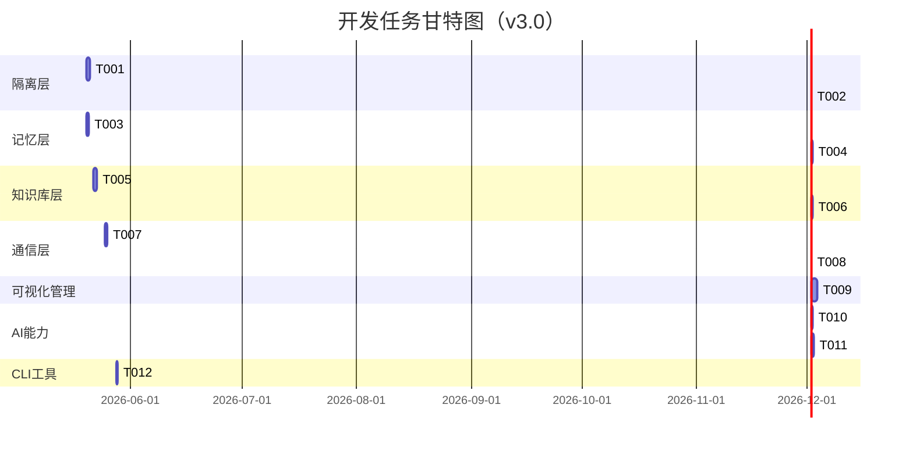
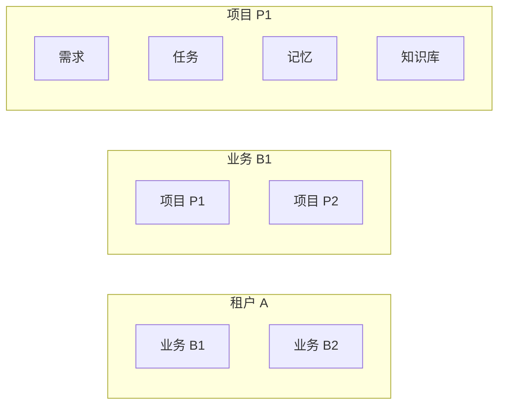
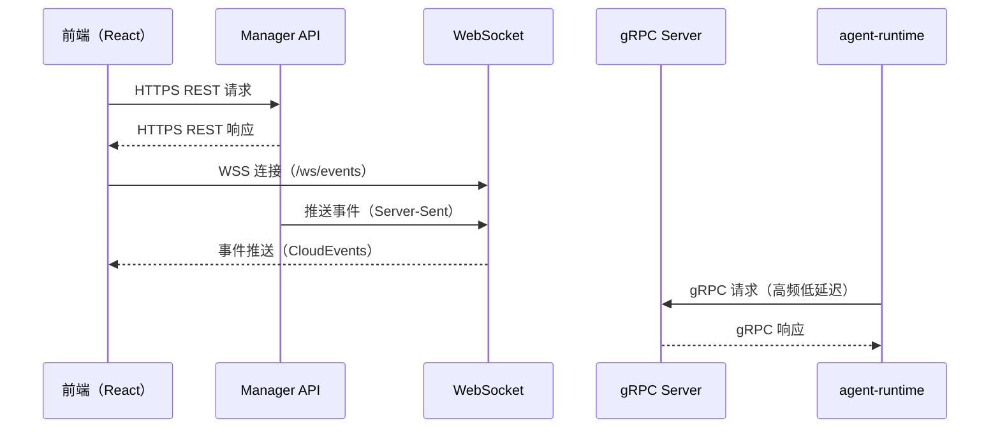

# 架构升级设计 v3.0 - 大型软件系统

> **版本**: v3.0-draft  
> **日期**: 2026-05-15  
> **架构师**: Software Architect  
> **基于**: v2.0-dev (ROADMAP + OVERVIEW + EVOLUTION)

**演进**：v4 与仓库对齐的整合版（双视图、三码隔离、CLI/同步/Epic）见 **[UPGRADE_v4_ENGINEERING.md](UPGRADE_v4_ENGINEERING.md)**。本文保留 Memory/Knowledge 的 OpenAPI 片段、SQL 样例与 ASCII 图，作为实现参考草案。

---

## 目录

1. [需求解析](#需求解析)
2. [升级架构总览](#升级架构总览)
3. [核心层设计](#核心层设计)
4. [多租户隔离设计](#多租户隔离设计)
5. [通信架构设计](#通信架构设计)
6. [可视化管理设计](#可视化管理设计)
7. [AI能力设计](#ai能力设计)
8. [开发任务规划](#开发任务规划)
9. [架构图汇总](#架构图汇总)

---

## 需求解析

### 用户需求 → 架构映射表

| # | 用户需求 | 架构层 | 关键设计 |
|---|----------|----------|----------|
| 1 | 记忆能力（mem0等） | 记忆层 | Memory Abstraction + mem0 adapter |
| 2 | 知识库系统 | 知识层 | Knowledge Base + RAG 2.0 |
| 3 | SOP CLI工具 | 工具层 | `sop` CLI 增强 |
| 4 | 租户/业务/项目隔离 | 隔离层 | tenant_code + business_code + project_code |
| 5 | 前后端分离+通信 | 通信层 | WebSocket + gRPC + Sync Protocol |
| 6 | 可视化管理 | 管理层 | manager-web v3 |
| 7 | AI数据分析 | AI层 | LLM Gateway + Data Analytics |
| 8 | 架构图+规划 | - | 本文档 |

---

## 升级架构总览

### v3 五层架构（升级自v2三层）

```
┌──────────────────────────────────────────────────────────┐
│                   工具层（v2 已有）                        │
│  Codex / Claude / Cursor / 自建 Agent                      │
│  hooks + MCP + A2A + CLI                                       │
└──────────────────────────────────────────────────────────┘
                           │ hooks/MCP/A2A
┌──────────────────────────────────────────────────────────┐
│                  SOP-CLI 层（新增）                        │
│  `sop` 统一入口 · init/login/status/agentd/task/rule/sync/llm   │
│  项目端 + 管理端 + 运维端 三端统一                        │
└──────────────────────────────────────────────────────────┘
                           │ stdio/IPC/HTTP
┌──────────────────────────────────────────────────────────┐
│              项目运行时层（v2 已有，增强）                   │
│  agent-runtime (Go) · Reporter · Puller · Watcher           │
│  Outbox · MCP Hub · A2A Node · Hook Bus                    │
│  🆕 新增：记忆模块 · 知识库模块 · 数据分析模块          │
└──────────────────────────────────────────────────────────┘
                           │ HTTPS REST/WSS/gRPC
┌──────────────────────────────────────────────────────────┐
│            Manager 管理层（v2 已有，增强）                  │
│  manager-api (FastAPI) · manager-worker (Queue+Temporal)       │
│  🆕 新增：多租户隔离 · 可视化管理 v3 · AI Copilot  │
│  🆕 新增：消息通道集成 · 智能运维           │
└──────────────────────────────────────────────────────────┘
                           │ Docker/K8s
┌──────────────────────────────────────────────────────────┐
│               基础设施层（v2 已有）                        │
│  Redis · PostgreSQL · LanceDB/Qdrant · OTel Collector  │
│  Prometheus · Grafana · Loki · Tempo · Temporal      │
└──────────────────────────────────────────────────────────┘
```

### 技术栈版本（升级）

| 组件 | v2 | v3 | 说明 |
|--------|-----|-----|------|
| **Manager API** | FastAPI (Python) | FastAPI + RBAC | 新增多租户中间件 |
| **Manager Worker** | Queue + Temporal | Temporal Cloud | 完整工作流引擎 |
| **agent-runtime** | Go 二进制 | Go + Plugin System | 新增记忆/知识库插件 |
| **前端** | Vite + React 18 + TS | Vite 6 + React 19 + TS 5.5 | 升级到最新 |
| **记忆系统** | Hermes 增强 | mem0 + LanceDB | 可扩展记忆 |
| **消息通道** | Webhook 出站 | 钉钉/企微/Slack 双向 | 智能运维 |

---

## 核心层设计

### 1. 记忆层设计（mem0 集成）

#### 架构

```
┌──────────────────────────────────────────────┐
│               记忆抽象层（Memory Abstraction）         │
├──────────────────────────────────────────────┤
│            │
│  ┌────────────┐    ┌────────────┐           │
│  │ 短期记忆  │    │ 长期记忆  │           │
│  │（Session） │    │（mem0）   │           │
│  └────────────┘    └────────────┘           │
│        │                │                    │
│        └────────┬────────┘                    │
│                 ▼                             │
│  ┌────────────┐                                  │
│  │ 记忆路由器  │                                  │
│  │（Memory Router）                                │
│  └────────────┘                                  │
│        │                                          │
│        ▼                                          │
│  ┌────────────┬────────────┬────────────┐           │
│  │ mem0      │ LanceDB   │ File      │           │
│  │ Adapter   │ Adapter   │ Adapter   │           │
│  └────────────┴────────────┴────────────┘           │
└──────────────────────────────────────────────┘
```

#### 记忆层 API 设计

```yaml
# apis/openapi/memory.yaml (部分)
paths:
  /api/v1/memory/{tenant_code}/{project_code}:
    post:
      summary: 写入记忆
      requestBody:
        content:
          application/json:
            schema:
              type: object
              properties:
                content:
                  type: string
                  description: 记忆内容
                metadata:
                  type: object
                  description: 元数据（category, importance, etc.）
                memory_type:
                  type: string
                  enum: [short_term, long_term, episodic]
              required: [content, memory_type]
      responses:
        '200':
          description: 写入成功
          content:
            application/json:
              schema:
                type: object
                properties:
                  memory_id:
                    type: string
                    format: uuid
    
    get:
      summary: 搜索记忆
      parameters:
        - name: q
          in: query
          description: 搜索关键词
          required: true
          schema:
            type: string
        - name: memory_type
          in: query
          schema:
            type: string
            enum: [short_term, long_term, all]
      responses:
        '200':
          description: 搜索结果
          content:
            application/json:
              schema:
                type: object
                properties:
                  memories:
                    type: array
                    items:
                      type: object
                      properties:
                        memory_id:
                          type: string
                        content:
                          type: string
                        score:
                          type: number
                          description: 相似度得分
```

### 2. 知识库层设计

#### 架构

```
┌──────────────────────────────────────────────┐
│              知识库抽象层（Knowledge Abstraction）        │
├──────────────────────────────────────────────┤
│            │
│  输入：                                     │
│  ┌────────┐  ┌────────┐  ┌────────┐           │
│  │ 文档  │  │ Web    │  │ 代码  │           │
│  └────────┘  └────────┘  └────────┘           │
│        │          │         │                      │
│        └──────────┼─────────┘                      │
│                     ▼                               │
│  ┌──────────────────────────────────┐           │
│  │  知识库流水线（Knowledge Pipeline）       │           │
│  │  1. Chunk（语义分块）                    │           │
│  │  2. Embed（向量化）                    │           │
│  │  3. Index（索引）                      │           │
│  │  4. Store（存储）                      │           │
│  └──────────────────────────────────┘           │
│                     │                               │
│                     ▼                               │
│  ┌────────────┬────────────┬────────────┐           │
│  │ LanceDB   │ Qdrant    │ File      │           │
│  │ Adapter   │ Adapter   │ Adapter   │           │
│  └────────────┴────────────┴────────────┘           │
└──────────────────────────────────────────────┘
```

#### 知识库 API 设计

```yaml
# apis/openapi/knowledge.yaml (部分)
paths:
  /api/v1/knowledge/{tenant_code}/{project_code}/documents:
    post:
      summary: 上传文档到知识库
      requestBody:
        content:
          multipart/form-data:
            schema:
              type: object
              properties:
                file:
                  type: string
                  format: binary
                metadata:
                  type: object
                  description: 文档元数据
              required: [file]
      responses:
        '202':
          description: 已接受，处理中
          content:
            application/json:
              schema:
                type: object
                properties:
                  job_id:
                    type: string
                    format: uuid
                  
  /api/v1/knowledge/{tenant_code}/{project_code}/search:
    post:
      summary: 知识库搜索
      requestBody:
        content:
          application/json:
            schema:
              type: object
              properties:
                query:
                  type: string
                top_k:
                  type: integer
                  default: 5
                score_threshold:
                  type: number
                  default: 0.7
              required: [query]
      responses:
        '200':
          description: 搜索结果
          content:
            application/json:
              schema:
                type: object
                properties:
                  results:
                    type: array
                    items:
                      type: object
                      properties:
                        content:
                          type: string
                        source:
                          type: string
                        score:
                          type: number
```

---

## 多租户隔离设计

### 隔离模型

```
┌──────────────────────────────────────────────┐
│           多租户隔离（三级隔离）                      │
├──────────────────────────────────────────────┤
│            │
│  Level 1: tenant_code（租户隔离）                  │
│    ┌─────────────────────────────────┐       │
│    │  租户 A                              │       │
│    │  ┌──────────┐  ┌──────────┐  │       │
│    │  │业务 B1  │  │业务 B2  │  │       │
│    │  └──────────┘  └──────────┘  │       │
│    └─────────────────────────────────┘       │
│                       │                             │
│  Level 2: business_code（业务隔离）               │
│    ┌─────────────────────────────────┐       │
│    │  业务 B1                             │       │
│    │  ┌──────────┐  ┌──────────┐  │       │
│    │  │项目 P1  │  │项目 P2  │  │       │
│    │  └──────────┘  └──────────┘  │       │
│    └─────────────────────────────────┘       │
│                       │                             │
│  Level 3: project_code（项目隔离）                  │
│    ┌─────────────────────────────────┐       │
│    │  项目 P1                             │       │
│    │  ┌──────────┐  ┌──────────┐  │       │
│    │  │需求    │  │任务    │  │       │
│    │  └──────────┘  └──────────┘  │       │
│    └─────────────────────────────────┘       │
└──────────────────────────────────────────────┘
```

### 数据库 Schema 设计

```sql
-- 租户表
CREATE TABLE tenants (
    tenant_code VARCHAR(32) PRIMARY KEY,  -- 租户编码
    tenant_name VARCHAR(128) NOT NULL,
    status TINYINT UNSIGNED NOT NULL DEFAULT 1 COMMENT '1=启用, 0=禁用',
    created_at DATETIME NOT NULL DEFAULT CURRENT_TIMESTAMP,
    updated_at DATETIME NOT NULL DEFAULT CURRENT_TIMESTAMP ON UPDATE CURRENT_TIMESTAMP,
    INDEX idx_status (status)
) ENGINE=InnoDB DEFAULT CHARSET=utf8mb4 COMMENT='租户表';

-- 业务表
CREATE TABLE businesses (
    business_code VARCHAR(32) PRIMARY KEY,  -- 业务编码
    tenant_code VARCHAR(32) NOT NULL,      -- 所属租户
    business_name VARCHAR(128) NOT NULL,
    status TINYINT UNSIGNED NOT NULL DEFAULT 1,
    created_at DATETIME NOT NULL DEFAULT CURRENT_TIMESTAMP,
    updated_at DATETIME NOT NULL DEFAULT CURRENT_TIMESTAMP ON UPDATE CURRENT_TIMESTAMP,
    INDEX idx_tenant_code (tenant_code),
    FOREIGN KEY (tenant_code) REFERENCES tenants(tenant_code)
) ENGINE=InnoDB DEFAULT CHARSET=utf8mb4 COMMENT='业务表';

-- 项目表
CREATE TABLE projects (
    project_code VARCHAR(32) PRIMARY KEY,   -- 项目编码
    business_code VARCHAR(32) NOT NULL,  -- 所属业务
    tenant_code VARCHAR(32) NOT NULL,   -- 所属租户
    project_name VARCHAR(128) NOT NULL,
    status TINYINT UNSIGNED NOT NULL DEFAULT 1,
    created_at DATETIME NOT NULL DEFAULT CURRENT_TIMESTAMP,
    updated_at DATETIME NOT NULL DEFAULT CURRENT_TIMESTAMP ON UPDATE CURRENT_TIMESTAMP,
    INDEX idx_tenant_business (tenant_code, business_code),
    FOREIGN KEY (business_code) REFERENCES businesses(business_code),
    FOREIGN KEY (tenant_code) REFERENCES tenants(tenant_code)
) ENGINE=InnoDB DEFAULT CHARSET=utf8mb4 COMMENT='项目表';
```

### 隔离中间件设计

```python
# routers/isolation.py
from fastapi import Request, HTTPException
from typing import Optional

async def isolation_middleware(request: Request, call_next):
    """三级隔离中间件"""
    
    # 从 JWT token 或 API Key 中解析隔离上下文
    tenant_code: Optional[str] = request.headers.get("X-Tenant-Code")
    business_code: Optional[str] = request.headers.get("X-Business-Code")
    project_code: Optional[str] = request.headers.get("X-Project-Code")
    
    # 验证权限
    if not tenant_code:
        raise HTTPException(status_code=400, detail="Missing X-Tenant-Code header")
    
    # 将隔离上下文注入到 request.state
    request.state.tenant_code = tenant_code
    request.state.business_code = business_code
    request.state.project_code = project_code
    
    # 验证业务/项目编码是否属于该租户
    if business_code:
        # 查询数据库验证
        pass
    
    response = await call_next(request)
    return response
```

---

## 通信架构设计

### 前后端通信架构

```
┌──────────────────────────────────────────────┐
│          前后端通信架构（高可用）                     │
├──────────────────────────────────────────────┤
│            │
│  ┌────────────┐          │
│  │  前端（manager-web）                          │
│  │  React 19 + TanStack Query              │
│  └────────────┘          │
│        │ HTTPS                                     │
│        ▼                             │
│  ┌────────────┐          │
│  │  Manager API（FastAPI）                       │
│  │  REST /api/v1/*                         │
│  └────────────┘          │
│        │ WSS                                      │
│        ▼                             │
│  ┌────────────┐          │
│  │  WebSocket 推送（/ws/events）                 │
│  │  CloudEvents 1.0                        │
│  └────────────┘          │
│        │                                     │
│  ┌────────────┐          │
│  │  原生客户端（Native Client）                  │
│  │  iOS / Android / Desktop                │
│  └────────────┘          │
│        │ gRPC（高频低延迟）                        │
│        ▼                             │
│  ┌────────────┐          │
│  │  agent-runtime（Go）                       │
│  │  gRPC :9090                            │
│  └────────────┘          │
└──────────────────────────────────────────────┘
```

### 同步协议设计

```yaml
# apis/asyncapi/sync.yaml (部分)
channels:
  sop/sync/{tenant_code}/{project_code}:
    publish:
      summary: 服务端发布同步事件
      message:
        name: SyncEvent
        contentType: application/json
        payload:
          type: object
          properties:
            event_id:
              type: string
              format: uuid
            event_type:
              type: string
              enum: [task_created, task_updated, memory_updated, knowledge_updated]
            payload:
              type: object
            timestamp:
              type: string
              format: date-time
    
    subscribe:
      summary: 客户端订阅同步事件
      message:
        $ref: '#/channels/sop/sync/{tenant_code}/{project_code}/publish/message'
```

---

## 可视化管理设计

### 管理界面架构

```
┌──────────────────────────────────────────────┐
│            可视化管理 v3（一体化）                       │
├──────────────────────────────────────────────┤
│            │
│  ┌────────────────────────────────────────────────┐  │
│  │  驾驶舱（Dashboard）                            │  │
│  │  - 需求管理（Kanban）                          │  │
│  │  - 任务管理（Gantt）                          │  │
│  │  - 进度追踪（Burndown Chart）                   │  │
│  └────────────────────────────────────────────────┘  │
│                       │                               │
│  ┌────────────────────────────────────────────────┐  │
│  │  运维中心（Ops Center）                         │  │
│  │  - 用户管理（RBAC）                          │  │
│  │  - 权限管理（ABAC）                          │  │
│  │  - 租户管理（CRUD + Quota）                     │  │
│  │  - 项目管理（CRUD + 隔离）                     │  │
│  │  - 消息通道配置（钉钉/企微/Slack）             │  │
│  └────────────────────────────────────────────────┘  │
│                       │                               │
│  ┌────────────────────────────────────────────────┐  │
│  │  AI 中心（AI Center）                          │  │
│  │  - LLM 路由配置                             │  │
│  │  - 记忆管理（查看/编辑/删除）                   │  │
│  │  - 知识库管理（上传/搜索/删除）                 │  │
│  │  - 数据分析（报表/图表）                     │  │
│  └────────────────────────────────────────────────┘  │
│                       │                               │
│  ┌────────────────────────────────────────────────┐  │
│  │  设置（Settings）                             │  │
│  │  - 个人设置                                       │  │
│  │  - 团队设置                                       │  │
│  │  - 系统设置（功能开关/特性标志）                  │  │
│  └────────────────────────────────────────────────┘  │
└──────────────────────────────────────────────┘
```

### 页面路由设计

```typescript
// apps/manager-web/src/router/routes.tsx
export const routes: RouteObject[] = [
  {
    path: "/",
    element: <MainLayout />,
    children: [
      // 驾驶舱
      { index: true, element: <DashboardPage /> },
      { path: "dashboard", element: <DashboardPage /> },
      
      // 需求管理
      { path: "requirements", element: <RequirementsPage /> },
      { path: "requirements/:id", element: <RequirementDetailPage /> },
      
      // 任务管理
      { path: "tasks", element: <TasksPage /> },
      { path: "tasks/:id", element: <TaskDetailPage /> },
      
      // 运维中心
      { path: "ops", element: <OpsLayout />,
        children: [
          { path: "users", element: <UsersPage /> },
          { path: "roles", element: <RolesPage /> },
          { path: "tenants", element: <TenantsPage /> },
          { path: "projects", element: <ProjectsPage /> },
          { path: "messaging", element: <MessagingPage /> },
        ],
      },
      
      // AI 中心
      { path: "ai", element: <AILayout />,
        children: [
          { path: "llm", element: <LLMGatewayPage /> },
          { path: "memory", element: <MemoryPage /> },
          { path: "knowledge", element: <KnowledgePage /> },
          { path: "analytics", element: <AnalyticsPage /> },
        ],
      },
      
      // 设置
      { path: "settings", element: <SettingsPage /> },
    ],
  },
];
```

---

## AI能力设计

### AI 数据分析架构

```
┌──────────────────────────────────────────────┐
│            AI 数据分析能力                            │
├──────────────────────────────────────────────┤
│            │
│  输入：                                     │
│  ┌────────┐  ┌────────┐  ┌────────┐           │
│  │ 需求数据  │  │ 任务数据  │  │ 记忆数据  │           │
│  └────────┘  └────────┘  └────────┘           │
│        │          │         │                      │
│        └──────────┼─────────┘                      │
│                     ▼                               │
│  ┌──────────────────────────────────┐           │
│  │  LLM Gateway（路由 + Fallback）              │           │
│  │  - Anthropic Claude                      │           │
│  │  - OpenAI GPT                             │           │
│  │  - 本地 Ollama                           │           │
│  └──────────────────────────────────┘           │
│                     │                               │
│                     ▼                               │
│  ┌──────────────────────────────────┐           │
│  │  分析流水线（Analytics Pipeline）            │           │
│  │  1. 数据聚合（Aggregation）                │           │
│  │  2. 趋势分析（Trend Analysis）              │           │
│  │  3. 异常检测（Anomaly Detection）            │           │
│  │  4. 预测（Forecasting）                  │           │
│  └──────────────────────────────────┘           │
│                     │                               │
│                     ▼                               │
│  ┌──────────────────────────────────┐           │
│  │  输出                                      │           │
│  │  - 报表（PDF/Excel）                     │           │
│  │  - 图表（Recharts）                       │           │
│  │  - 自然语言摘要（LLM生成）                │           │
│  └──────────────────────────────────┘           │
└──────────────────────────────────────────────┘
```

---

## 开发任务规划

### 任务分解（按优先级）

| 任务ID | 任务名称 | 所属层 | 预估工时 | 依赖 | 优先级 |
|---------|----------|--------|----------|------|----------|
| **T001** | 多租户数据库迁移（Alembic） | Manager API | 8h | - | P0 |
| **T002** | 隔离中间件实现 | Manager API | 4h | T001 | P0 |
| **T003** | mem0 适配器实现 | 项目运行时 | 12h | - | P0 |
| **T004** | 记忆层 API 实现 | Manager API | 8h | T002 | P0 |
| **T005** | 知识库流水线实现 | 项目运行时 | 16h | - | P1 |
| **T006** | 知识库 API 实现 | Manager API | 8h | T002, T005 | P1 |
| **T007** | gRPC 通信实现 | agent-runtime | 12h | - | P1 |
| **T008** | WebSocket 推送增强 | Manager API | 6h | T002 | P1 |
| **T009** | 可视化管理 v3 前端 | manager-web | 40h | T004, T006 | P1 |
| **T010** | 消息通道集成（钉钉/企微） | Manager API | 12h | T002 | P2 |
| **T011** | AI 数据分析实现 | Manager API | 16h | T004, T006 | P2 |
| **T012** | SOP CLI 增强 | sop-cli | 12h | - | P2 |

### 甘特图



---

## 架构图汇总

### 图1：v3 五层架构图

```mermaid
graph TB
    subgraph "工具层"
        A1[Codex CLI]
        A2[Claude Code]
        A3[Cursor]
        A4[自建 Agent]
    end
    
    subgraph "SOP-CLI 层"
        B1[sop CLI<br/>init/login/status]
        B2[agentd 子命令]
        B3[task/rule/sync 子命令]
        B4[llm 子命令]
    end
    
    subgraph "项目运行时层"
        C1[agent-runtime<br/>(Go)]
        C2[记忆模块]
        C3[知识库模块]
        C4[数据分析模块]
        C5[MCP Hub]
        C6[A2A Node]
    end
    
    subgraph "Manager 管理层"
        D1[manager-api<br/>(FastAPI)]
        D2[manager-worker<br/>(Temporal)]
        D3[多租户中间件]
        D4[可视化管理 v3]
        D5[AI Copilot]
    end
    
    subgraph "基础设施层"
        E1[(Redis)]
        E2[(PostgreSQL)]
        E3[(LanceDB)]
        E4[Prometheus]
        E5[Grafana]
    end
    
    A1 -->|hooks/MCP| B1
    A2 -->|hooks/MCP| B1
    B1 -->|stdio/IPC| C1
    C1 -->|HTTPS REST/WSS| D1
    D1 -->|gRPC| C1
    C1 --> E1
    C1 --> E2
    C1 --> E3
    D1 --> E1
    D1 --> E2
```

### 图2：多租户隔离模型



### 图3：通信架构



---

## 下一步行动

| 步骤 | 行动 | 负责人 | 期望完成 |
|------|------|----------|----------|
| 1 | 评审本架构设计文档 | 你（人类） | 2026-05-16 |
| 2 | 批准/提出修改建议 | 你（人类） | 2026-05-17 |
| 3 | 开始执行 T001（多租户数据库迁移） | AI Agent | 2026-05-20 |
| 4 | 每周同步进度 | AI Agent + 你 | 每周五 |

---

> 本文档由 Software Architect AI 生成，基于 v2.0-dev 架构。
> 关键决策请由人工复核。
