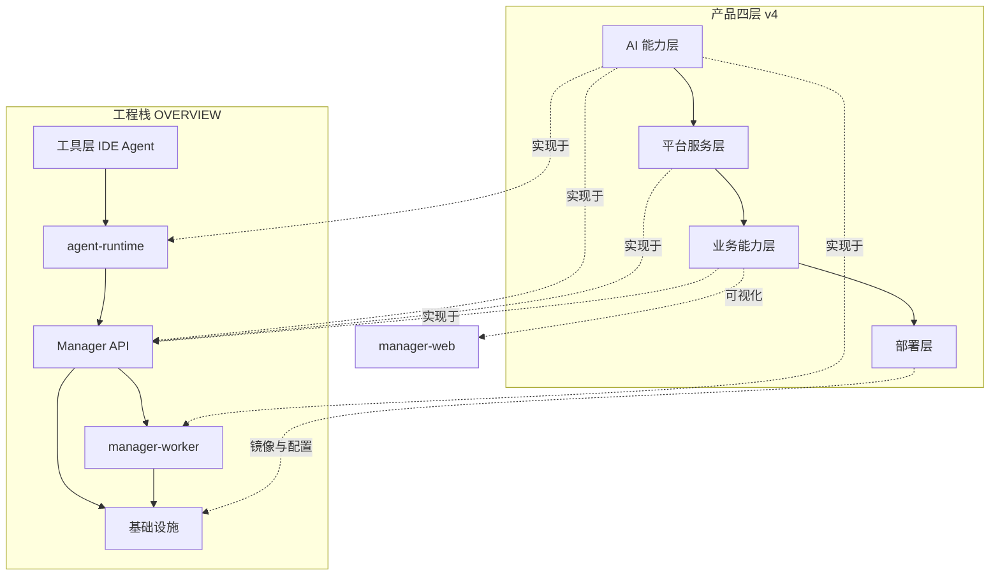
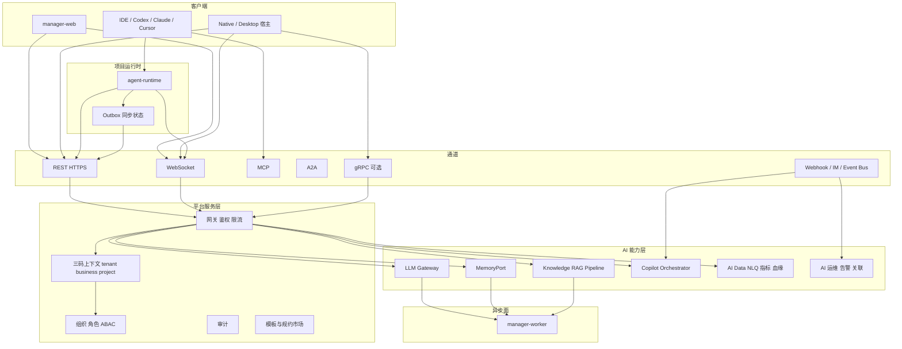
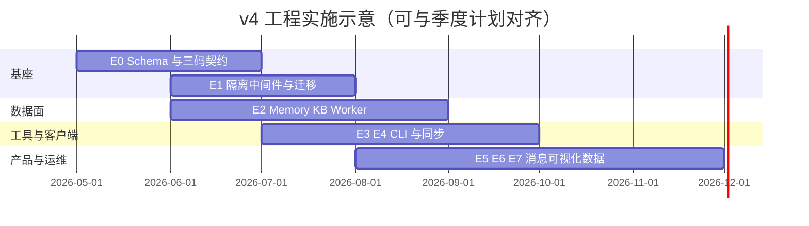

# AI 一栈式平台 — 架构升级工程说明（v4）

> **版本**: v4.0-engineering  
> **日期**: 2026-05-15  
> **状态**: 与仓库实现对齐的**工程真源**（产品叙事见同目录 `ai-platform-v4-architecture.html`）  
> **依赖文档**: [OVERVIEW.md](OVERVIEW.md) · [EVOLUTION.md](EVOLUTION.md) · [AI_FIRST.md](AI_FIRST.md) · [MODULES.md](MODULES.md) · [UPGRADE_v3_ARCHITECTURE.md](UPGRADE_v3_ARCHITECTURE.md)

---

## 1. 文档关系与阅读顺序

| 读者目的 | 推荐阅读 |
|----------|----------|
| 产品价值、四层能力地图 | `ai-platform-v4-architecture.html`（浏览器打开） |
| 通道、目录、里程碑、设计原则 | [OVERVIEW.md](OVERVIEW.md) + [EVOLUTION.md](EVOLUTION.md) |
| **本文**：隔离模型、记忆/知识、CLI、同步、Epic 与代码落点 | 当前文件 |
| v4+ 目标态、产业化/商业化路线、开发任务包 | [AI_PLATFORM_TARGET_ARCHITECTURE.md](AI_PLATFORM_TARGET_ARCHITECTURE.md) |
| OpenAPI 片段、示例 SQL、ASCII 细图 | [UPGRADE_v3_ARCHITECTURE.md](UPGRADE_v3_ARCHITECTURE.md) |
| AI 改码规范、MCP、Copilot、闭环 | [AI_FIRST.md](AI_FIRST.md) |

---

## 2. 设计目标（工程化表述）

| 维度 | 目标 |
|------|------|
| **可扩展 AI** | LLM / 记忆 / 知识库 / Agent 均以 **Ports & Adapters** 接入，禁止单供应商锁死 |
| **多域隔离** | `tenant_code` → `business_code` → `project_code` 全链路一致（DB、向量、对象存储、审计） |
| **双模交付** | 同一套二进制与契约支持本地化与 SaaS；敏感数据可留在客户域 |
| **CLI 一等公民** | `sop` 为项目端、管理端、运维端的统一入口（上下文切换，而非多套 CLI） |
| **高可用通信** | REST + WSS 默认；gRPC 可选；同步幂等与 Outbox；见 [OVERVIEW.md](OVERVIEW.md) 五通道 |
| **可演进** | Schema-First、12 个月兼容窗口、Feature Flag（见 [EVOLUTION.md](EVOLUTION.md)） |

---

## 3. 双视图：产品四层 × 工程五通道

**产品视图（v4 HTML）**：AI 能力层 → 平台服务层 → 业务能力层 → 部署层。

**工程视图（OVERVIEW v2）**：工具层 → `agent-runtime` → Manager（API + Worker）→ 基础设施；数据面通过 REST / WSS / MCP / A2A / gRPC / Webhook / Event Bus 接入。

二者关系：**四层描述「能力与治理边界」**，**五通道描述「集成与协议」**。实现时每个能力模块必须声明其主通道与降级通道（例如检索：REST 同步 + Worker 异步索引）。

---

## 4. 逻辑架构（控制面 + 数据面）

---

## 5. 三码隔离（tenant / business / project）

### 5.1 模型

| 层级 | 编码 | 边界含义 |
|------|------|----------|
| L1 | `tenant_code` | 企业 / 订阅 / 合规域 |
| L2 | `business_code` | 租户内产品线或事业部 |
| L3 | `project_code` | 交付单元；与代码仓、路径、任务空间绑定 |

**存储**：关系型数据表以 `(tenant_code, …)` 为最左索引；向量与对象存储使用**服务端映射**的 collection/bucket 命名，避免客户端随意拼桶名。

### 5.2 请求上下文（推荐）

1. **JWT**：主体、租户、可选业务列表、默认项目。  
2. **显式 Header（自动化 / 调试）**：`X-Tenant-Code`、`X-Business-Code`、`X-Project-Code`（与 `ai-sop/specs/database` 约定一致）。  
3. **过渡期**：当前实现以 `tenant_id` + `X-Project-Id`（项目主键）为主；**迁移策略**为「双写三码与旧键 → 双读校验 → 读切换 → 停写旧键」，见 [EVOLUTION.md](EVOLUTION.md) 影子双写。

### 5.3 与现有代码对齐点

- 请求级项目作用域：`project_scope_middleware.py` + `project_scope_resolve.py`（JWT + `X-Project-Id` + 租户校验 + v4 三码头一致性 + `set_request_scope`）。  
- **增强方向**：在同一中间件链中解析 `business_code` / `project_code`（或与 `project_id` 映射表），并在所有 Memory/KB/任务查询中强制带上三码谓词。

---

## 6. 记忆系统（可扩展）

### 6.1 MemoryPort 能力

建议接口语义（名称可映射到具体语言模块）：`put`、`search`、`forget`、`summarize`、`attach_run`（关联一次 Agent 运行 ID 便于审计）。

### 6.2 适配器优先级

| 适配器 | 场景 |
|--------|------|
| Session / Redis | 短期、低成本 |
| mem0 或 API 兼容实现 | 长期跨会话、策略化遗忘 |
| LanceDB / Qdrant / pgvector | 本地优先、数据不出域 |
| 文件 / Git 片段 | 规约与冷存储 |

**原则**：先 **抽象 + 一种默认实现**（见 OVERVIEW P4），再挂 mem0；禁止业务路由直接 `import mem0`。

### 6.3 详细契约草案

见 [UPGRADE_v3_ARCHITECTURE.md](UPGRADE_v3_ARCHITECTURE.md) 中 Memory 路径与 YAML 片段；正式契约应收敛到 `apis/openapi` 并走 Schema-First（M2）。

### 6.4 当前仓库实现（MVP）

| 项 | 说明 |
|----|------|
| 后端 | `sop_manager/memory_store.py`（`FileJsonlMemoryStore`，`MEMORY_BACKEND=file`）+ `routers/memory_api.py`：`GET /api/v1/memory/health`、`POST /api/v1/memory`、`GET /search`、`GET /recent`；文件分区键来自 `path_config` 的 tenant/business/project 解析 |
| SDK | `ManagerClient.memory_health` / `memory_add` / `memory_search` / `memory_recent`；`knowledge_search_workspace` |
| CLI | `sop memory health \| recent \| search \| add` |
| 前端 | `manager-web` 路由 `#/intelligence`：知识库检索 Tab + 记忆读写 Tab（调用上述 API） |
| 扩展 | `get_memory_store()` 支持 `MEMORY_BACKEND=file|http`；http 走 `memory_adapters/http.py`（mem0 兼容 URL） |
| 同步 | `routers/sync_api.py`：`GET /api/v1/sync/pull`（游标拉取 tasks/requirements/issues/sprints/rules/specs/templates） |
| Worker | `routers/worker_jobs.py` + `sop-worker` handlers（`kb.index` 等 Redis Streams） |
| CLI | `sop kb` / `sop ops` / `sop sync pull` |
| 前端 | `#/organization` `#/analytics` `#/notify`；Intelligence 增加 RAG Tab |

---

## 7. 知识库与 RAG

- **流水线**：摄取 → 分块 → 嵌入 → 索引；长任务必须在 **manager-worker** 执行，API 仅返回 `202` + `job_id`。  
- **分区**：与三码一致；检索前在服务端校验「用户可访问该 project」。  
- **v4「RAG 2.0 / 图谱」**：作为**可选增强插件**，不作为第一版本硬依赖。

OpenAPI 形状参考：[UPGRADE_v3_ARCHITECTURE.md](UPGRADE_v3_ARCHITECTURE.md) 知识库章节。

---

## 8. `sop_cli` 与管理运维工具

**真源包**：`packages/sop-cli`（Typer 聚合入口 `sop_cli/__main__.py`）。

### 8.1 当前已具备子命令

`init`、`login`、`status`、`agentd`、`task`、`rule`、`sync`、`doctor`、`llm`。

### 8.2 建议增量（与 v4 能力对齐）

| 域 | 子命令方向 |
|----|------------|
| 上下文 | `context` / `whoami`（多租户 profile） |
| 记忆与知识 | `memory`、`kb`（上传 / 检索 / 任务状态） |
| 编排 | `copilot`（触发会话、绑定 run_id） |
| 运维 | `ops`（webhook、告警订阅、日志 tail） |
| 资产 | `template`、`marketplace`（与模板中心一致） |

管理端可视化以 **manager-web** 为主；批处理与索引以 **manager-worker** 为主（`apps/manager-worker/README.md` 为占位时按 M8 补齐）。

---

## 9. 前后端分离 · SaaS Manager · Native 与同步

### 9.1 职责

| 组件 | 职责 |
|------|------|
| **manager-web** | SPA；需求、项目、权限、知识、运维视图 |
| **Manager API** | 同步 CRUD、鉴权、会话、Copilot 入口 |
| **manager-worker** | 嵌入、报告、批处理、工作流 |
| **agent-runtime** | 本地守护、Watcher、Outbox、MCP Hub |
| **Native** | 桌面或移动端壳；优先复用 runtime + 少量 UI；协议与 WEB 一致 |

### 9.2 同步与一致性

- **幂等键** + **游标（cursor）** 拉取变更；冲突策略对「规约类文本」可用 LWW 或三路合并；对「结构化任务」以服务端版本为准。  
- **实时**：WSS 推送任务状态、索引完成、告警。  
- **离线**：本地 Outbox；恢复后按游标重放。

---

## 10. 消息通道与智能化运维

- **出站**：Webhook（已有方向）+ HMAC；见安全章节 [SECURITY.md](SECURITY.md)。  
- **入站 / 双向**：钉钉、企微、Slack 等连接器归一为 **Message Channel Port**，与 AI 运维（关联、摘要、Runbook 建议）在同一事件总线上消费。  
- **CloudEvents**：与 [OVERVIEW.md](OVERVIEW.md) 推送语义对齐，便于多订阅方。

---

## 11. 一体化可视化管理域

建议在 **manager-web** 按域迭代，共用权限与布局基座：

- 租户 / 组织 / 成员 / 角色  
- 业务线 / 项目 / 需求与迭代 / 进度  
- 规约与模板、知识库与记忆审计（脱敏）  
- Worker 任务、告警、Webhook 配置  
- **AI 数据分析**：指标目录、NLQ、导出（对接 DAT 子系统）

交互规范与 Copilot 行为见 [AI_FIRST.md](AI_FIRST.md)。

---

## 12. 产业化 · 商业化 · 企业化

| 主题 | 要点 |
|------|------|
| **产业化** | 标准镜像、版本化契约、插件 entry_points（[MODULES.md](MODULES.md)） |
| **商业化** | 租户配额（token、向量存储、Worker 并发）、计费事件从审计与用量管道出账 |
| **企业化** | SSO/SAML、ABAC、多区域、列加密与密钥轮换（M10/M12） |
| **沉淀与共享** | 规约包、技能、流水线模板统一 **资产注册表**（类型 + 三码 + 版本 + 许可证范围） |

---

## 13. Epic 与里程碑映射

与 [EVOLUTION.md](EVOLUTION.md) 中 M2–M12 对齐的**实施打包**：

| Epic | 内容 | 主要里程碑 |
|------|------|------------|
| E0 | Schema-First：三码出现在 OpenAPI / SDK | M2 |
| E1 | 三码模型 + 中间件 + DB 迁移 | M6 前 |
| E2 | MemoryPort + KB MVP + Worker 索引管道 | M5 |
| E3 | `sop` 子命令：`context`、`memory`、`kb`、`ops`；`sync pull` | M3 |
| E4 | 同步协议（cursor、Outbox、WSS） | M4、M9 |
| E5 | 消息通道与 AI 运维事件 | M9、M11 |
| E6 | manager-web 域模块扩展 | M11、M12 |
| E7 | AI Data（指标、NLQ、血缘） | M5、M11 |

---

## 14. 与当前仓库的差异说明（诚实基线）

| 项 | 当前状态 | v4 目标 |
|----|----------|---------|
| 项目作用域 | `X-Project-Id` + `tenant_id`；**已实现** ContextVar 三码（`tenant_code`=slug、`business_code`、`project_code`=project id）及 SDK 请求头 | OpenAPI 正式字段；独立 `project_code` 列与校验 |
| manager-worker | **任务投递 API** + `kb.index` handler（Redis Streams 可选）；见 `worker_jobs.py` / `sop_worker/handlers.py` | Temporal、完整工作流真源 |
| mem0 | **file + http 适配器**（`MEMORY_HTTP_URL`）；`forget/summarize/attach-run` API/CLI 已补齐；非 SDK 内嵌 | mem0 原生 SDK、策略化遗忘审计 |
| Native 独立安装包 | 未定义 | 以 runtime + 薄壳为默认路径 |
| CLI | **context / memory / kb / ops / sync pull+push / platforms** | Native 壳、完整 ops 子命令 |
| agent-runtime | **Puller + Outbox sync.push**；定时 pull + IPC | WSS 订阅、Watcher |
| 可视化 | **organization / analytics / notify** + Intelligence RAG | 全量 ERP 级域模块 |

---

## 15. 变更记录

| 日期 | 说明 |
|------|------|
| 2026-05-15 | 初版：整合 v4 HTML 与 OVERVIEW / v3 / AI_FIRST，作为工程真源 |
| 2026-05-15 | 记忆 MVP：`memory_store` + `/api/v1/memory` + `sop memory` + manager-web `#/intelligence` |
| 2026-05-15 | 同步闭环：`sync/push` + journal + WSS；`context/me`；顶栏 ProjectSelector；Copilot 注入记忆/RAG；`sop copilot` |
| 2026-05-15 | 多平台：registry + Platforms 管理页 + `sop platforms`；init 生成 Cursor/WorkBuddy/Hermes/Windsurf hooks |
| 2026-05-15 | 平台接入增强：新增 registry 驱动 `platforms/onboard.py` 与 `sop platforms init`，`sop init` 自动产出 onboarding manifest |
| 2026-05-15 | agent-runtime Puller + Pusher 闭环；manager-web 任务看板/Sprint；`SYNC_AND_PLATFORMS.md` 使用文档 |
| 2026-05-15 | sync 扩展：`rules/specs/templates` 规约资产进入 pull 默认模块，agentd 本地物化到 syncstore；push 支持写入项目自有扩展目录 |

---

**置信度**：关于文档结构与仓库目录的对齐约 **0.9**；Native 壳技术选型、默认向量库以团队 NFR 签字为准（约 **0.75**）。
